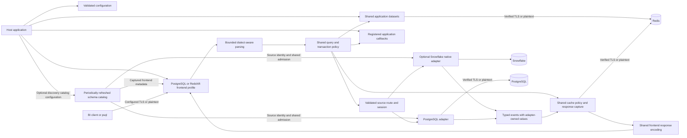
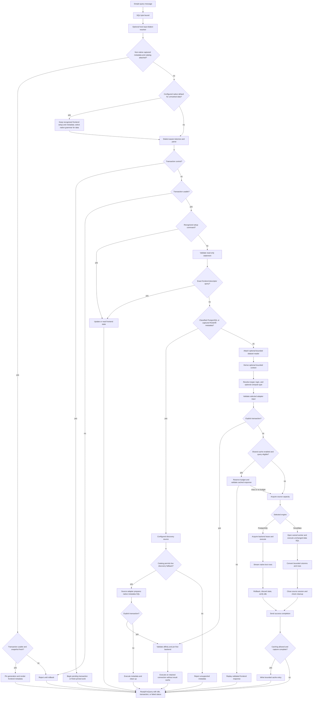
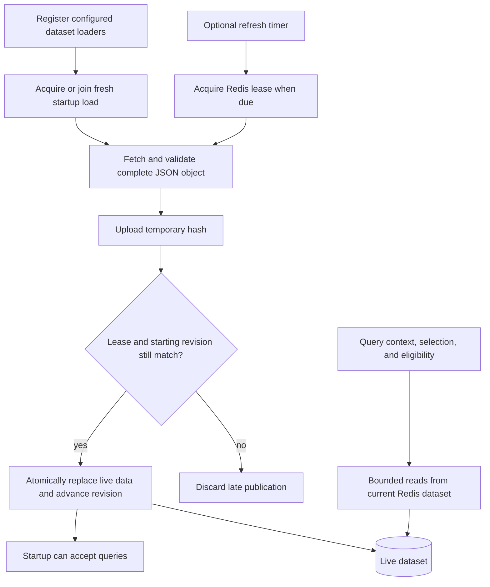
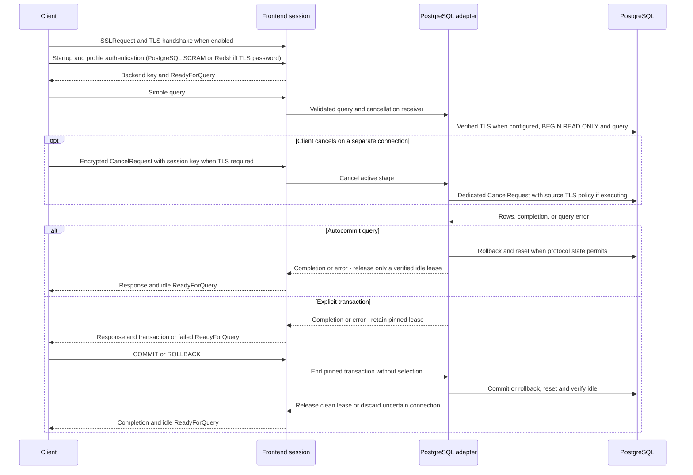

# Current architecture

YASP accepts PostgreSQL clients over independently configured TLS or plaintext connections
and offers an experimental Redshift password profile over TLS. Both execute supported read-only
simple queries against configured PostgreSQL or optional Snowflake bindings.
Source roles enforce access. Application-specific identity mapping and policy belong to
the consuming host. See the [plan](PLAN.md) for the multi-engine product direction.

## Component ownership

| Component                       | Code                                                                                             | Responsibility                                                                                                                                                     |
| ------------------------------- | ------------------------------------------------------------------------------------------------ | ------------------------------------------------------------------------------------------------------------------------------------------------------------------ |
| Host                            | [main.rs](../src/main.rs), [host/](../src/host)                                                  | CLI, environment resources, logging, compiled callback registration, and process lifecycle.                                                                        |
| Configuration                   | [config.rs](../src/config.rs), [config/](../src/config)                                          | Public facade; YAML topology/loading, settings/defaults/validation, and secret-bearing runtime configs.                                                            |
| Shared pgwire frontend          | [gateway.rs](../src/gateway.rs), [gateway/](../src/gateway)                                      | Listener/shutdown and authentication in `server`/`session`; bounded parsing in `query`; profile response and error encoding in `result`.                 |
| Shared execution | [execution.rs](../src/execution.rs), [execution/](../src/execution) | Ordered validation/discovery/context/routing stages and transaction state; typed requests, responses, and failures without wire messages or source connection objects. |
| SQL and metadata classification | [query.rs](../src/query.rs), [discovery.rs](../src/discovery.rs), [discovery/](../src/discovery) | Bounded immutable PostgreSQL, Redshift, or Snowflake AST; separate catalog allowlists, metadata classification, and frontend setup state.                                                  |
| Extension contracts             | [hooks.rs](../src/hooks.rs), [hooks/](../src/hooks)                                              | Separate context, selection, cache-eligibility, and dataset-loader contracts; bounded JSON payloads and optional Python runtime, interpreter, and conversion code. |
| Shared application datasets     | [datasets.rs](../src/datasets.rs)                                                                | Startup-loaded JSON mappings shared through bounded Redis lookup helpers by context and query callbacks.                                                           |
| Shared schema catalog          | [catalog.rs](../src/catalog.rs), [catalog/](../src/catalog), [gateway/metadata.rs](../src/gateway/metadata.rs) | Bounded periodic schema snapshots, source coordinates/native types, age/status, and captured frontend metadata responses. AST lineage remains future work. |
| Backend boundary                | [backend.rs](../src/backend.rs), [backend/discovery.rs](../src/backend/discovery.rs)             | Public PostgreSQL exports; concrete route/pinned-session dispatch in `backend/execution`; typed failures/events in `backend/result`; metadata dispatch in `backend/discovery`.                                                                                            |
| PostgreSQL adapter              | [backend/postgres.rs](../src/backend/postgres.rs), [backend/postgres/](../src/backend/postgres)  | Read-only execution; native connection I/O, pooling/cleanup, metadata adaptation, and verified completion/source identity.                                       |
| Experimental Snowflake adapter | [backend/snowflake.rs](../src/backend/snowflake.rs), [backend/snowflake/](../src/backend/snowflake) | Optional native ADBC connector, typed identities, blocking workers, cancellation, Arrow-to-text conversion, transaction ownership, and normalized schema provider. Mixed bindings use `backend::Backends`. |
| Shared cache                    | [cache.rs](../src/cache.rs), [cache/](../src/cache)                                                                      | Backend-independent eligibility/capture/replay, source scope, complete frontend response validation, bounded Redis storage, expiry and miss-on-error behavior.                                                        |
| Support                         | [wire.rs](../src/wire.rs), [transport.rs](../src/transport.rs), [logger.rs](../src/logger.rs)                               | Shared pgwire value encoding, frame bounds before payload allocation and redacted logging setup. `policy.rs` is a future component placeholder.                                           |

These are concrete modules within one package. Shared orchestration and transaction
state use typed `ExecutionRequest`, `SessionRequest`, `ResultEvent`, `ExecutionError`, `Route`, and
`PinnedSession` contracts. They do not depend on PostgreSQL wire messages/errors,
source SQL, or native connection objects. The frontend owns authenticated password
and TLS material and passes only identity and bounded services into execution.

The PostgreSQL adapter owns native value/error representations, pool admission,
read-only transaction setup and source cleanup. Its response/error values pass
through the shared layer opaquely, retaining native field metadata and text without
JSON conversion. Shared frontend encoding also handles converted source events; the
engine captures that response only when caching is enabled and budget is available. Existing public PostgreSQL library entry points retain their
wire-oriented signatures. Adding another source extends the concrete dispatcher and
provides its own result/session implementation after its connector gates pass.

## Query flow

`ParsedQuery` keeps original SQL, typed input options, and an immutable statement
tree. A host resolver may select a native grammar before tokenization and parsing;
unknown/missing Metabase remarks retain the listener's grammar unless an explicit native-data default is configured. Native SQL always
uses ordinary context and routing and never borrows discovery access. PostgreSQL
source affinity is enforced before cache or pool acquisition. Frontend fingerprints
describe the configured frontend. PostgreSQL discovery preserves its source version; Snowflake discovery advertises PostgreSQL 18.0 or Redshift 8.0.2. Supported reads
include SELECT, read-only WITH/subqueries/joins/aggregates/unions, catalog queries,
and supported SHOW requests. Application query rewrites are not implemented; the
metadata adapter does rewrite catalog SQL. Parsing has a default
1 MiB SQL limit, 4,096 significant tokens, and recursion budget 64. Unicode escaped
identifiers are unsupported. Inspection does not analyze custom function bodies;
PostgreSQL read-only transactions and source grants remain necessary.

Context runs once for each ordinary query, including cache hits. It cannot replace
authenticated frontend identity. Context errors supply an empty mapping; selector
errors stop the query; eligibility errors bypass caching. See [extensions](extensions.md).

The host loads registered application datasets before it serves clients. Rust and
Python callbacks receive an optional `DatasetReader`; each lookup reads the latest
Redis value and is bounded by configured byte and field limits. Startup load failures
prevent service. Scheduled refreshes retain the last successful values while a new
load runs and leave them in place after a failed refresh. Dataset storage uses a Redis
namespace separate from the result cache; see [configuration](configuration.md#shared-application-datasets).

The timer is absent when every refresh interval is zero. Refresh errors leave the
live dataset available. Staging keys expire; live data has no TTL. The library does
not provide manual refresh or invalidation controls in this phase.

## Compute and connection ownership

A target can expose optional compute types with ordered physical instances. The
application selector returns the source/login and optional type; overflow is
engine-owned and never changes those decisions. Login-specific pools preserve
source authentication while instance limits cover all logins together.

Physical connection budgets include idle sessions and remain held until socket
closure. Idle pressure reclamation lets a different login use shared capacity.
Queries wait asynchronously under `backend.acquire_timeout_ms` when capacity is
exhausted, then receive `53300`. Session limits bound waiting queries;
Redis query queuing is future work. Cache replay acquires no compute lease.

## Discovery and frontend state

The optional [shared catalog](catalog.md) imports bounded PostgreSQL or Snowflake
schema definitions and periodically publishes immutable generations. Exact captured
JDBC schema/table/column/key requests and the captured BI definition-discovery scans
use frontend-specific snapshot responses before general parsing. The PostgreSQL
provider includes declared primary-key membership for the field scans. The YAML
host attaches a catalog when `schema_discovery.catalog` defines an explicit schema
scope, using the discovery binding's adapter capacity and identity.
Native SQL skips this path. Responses pin a generation and use no
backend transaction, context hook, selector or result cache. Unknown warehouse
metadata requests fail explicitly. The schema model also exposes qualified column
coordinates for future AST binding; it does not resolve lineage or apply masks.

Recognized catalog reads use the configured discovery target/login and optional
compute instance, sharing capacity limits while bypassing
application hooks and the result cache. The frontend classifier checks nested
relations, functions, and casts, including nonrecursive metadata-only CTEs.
Allowlisted privilege/type probes and schema/version probes use this route even
without a catalog table or when their functions appear in FROM.
Mixed application/catalog reads, recursive CTEs, CTEs that shadow native catalog
names, TABLE set expressions, and unrecognized helpers follow ordinary routing.
Source-role visibility still applies.
Captured SQLAlchemy Redshift relation, column and constraint reflection queries
also use this live discovery path. Complete statement templates accept only
bounded literal schema/table predicates; the PostgreSQL adapter produces native
catalog SQL and preserves source types, definitions and declared keys. Physical
Redshift storage properties remain NULL. This path uses discovery-source
permissions independently of snapshot schema scope. A Snowflake catalog rejects
this PostgreSQL fallback explicitly and serves supported reflection from normalized
facts, virtual identifiers, view definitions and declared keys. Client fixtures are in
[`superset_redshift.json`](../tests/fixtures/superset_redshift.json).
The PostgreSQL handler qualifies native names, limits database listings to the
source database, and applies discovery session state inside the existing read-only
transaction. The source must be reachable at startup to supply its server version.

Frontend state supports bounded `application_name` and `search_path`, matching SHOW
requests, and reaffirming fixed encoding/text/read-only settings. Both discovery
and ordinary execution replay these settings. Explicit transactions retain their
initial frontend settings for rollback; commit preserves supported changes.
Autocommit cache scope includes these settings. Client setup is in
[configuration](configuration.md#discovery-and-client-setup).

`BEGIN` records a pending read-only, read-committed transaction without selecting a
backend. The first backend operation pins its actual physical connection. Each
ordinary statement still runs context and selection; its route must permit that
connection. Discovery retains its independently configured binding and fails on a
conflicting pin. Transaction controls need no context or fresh selection. Explicit
transactions bypass cache reads and writes. Errors produce failed transaction
status until rollback; commit in failed state rolls back.

## Sessions, cancellation, and cleanup

TLS material loads before session admission. Frame bounds apply to decrypted
PostgreSQL messages. A bounded TLS bridge observes decrypted Terminate messages,
TLS closure, and EOF while a query executes. TLS negotiation shares the startup
deadline; no verification failure falls back to plaintext. See [TLS setup](tls.md).

The gateway admits bounded extra cancel-only connections even when normal session
slots are occupied. Cancellation can stop context, selection, cache waits, or active
backend work; PostgreSQL cancellation uses a separate source connection. Snowflake
uses operation-scoped native cancellation on a blocking worker and retains source
capacity through stream release and cleanup. A cancelled PostgreSQL
lease is discarded, preventing a delayed cancel from reaching a future borrower.
Cancellation reports `57014`; explicit transactions require rollback before further
queries. The message-read deadline bounds idle and partial-message transactions,
including pending transactions. A disconnect
abandons its active execution; interrupted or unhealthy leases are discarded.

Reusable leases require rollback, `DISCARD ALL`, restoration of fixed settings,
idle-state verification, and a health query. Unsupported ParameterStatus changes,
unread protocol messages, cleanup failures, and cancellation prevent unsafe reuse.
PostgreSQL success completion follows cleanup. Shutdown stops admission, stops hook admission,
drains sessions to the configured deadline, then closes pools and cache resources.

Snowflake bindings currently use fresh source connections. Explicit frontend
transactions retain one connection until commit/rollback or abandonment. Native
parents retain their source capacity until every child releases; failed native
release retires the binding and retains the failed handle addresses. Snowflake
batch/frame bounds reject oversized results, but the Arrow batch check occurs
after allocation and does not hard cap native RSS. Supported types and remaining
acceptance gates are in [multi-engine compatibility](multi-engine.md).

## Values and cache ownership

PostgreSQL column metadata and text rows stream without conversion through JSON or
a Rust numeric model. NULLs, type identifiers, and text values retain their native
representation. The adapter validates text row framing. `wire.rs` encodes both
frontend profiles; `cache/execution.rs` owns cache policy/scope and
`cache/response.rs` captures, validates and replays the complete frontend response
for every backend. Adapters supply source identity and verified completion, with
no per-backend cache switch.

Shared Redis code stores a versioned opaque payload under a namespace and normalized
SQL SHA-256 identifier together with configured target/login names. Separate named
pairs retain separate entries. Scope also validates frontend identity/database,
frontend profile and input dialect/mode, compute instance, backend
endpoint/database/principal, Snowflake role/warehouse/schema, fixed text settings,
effective search path/application name, query/write timers, frame bound and
codec/execution revision. Overflow fills record the actual physical source.
Different physical scopes within a named pair can
replace its SQL slot; validation prevents cross-scope replay. Derived context does
not partition cache entries.

Only complete successful results within row and byte limits are stored. Oversized
results continue streaming. Redis errors, deadlines, malformed entries, and scope
mismatches become misses. Hits do not contact the backend, so grants and row-level
security are not rechecked until expiry. Buffer accounting and cache settings are in
[configuration](configuration.md#redis-result-cache). Future policy and masking must
process both hits and misses before client output.
