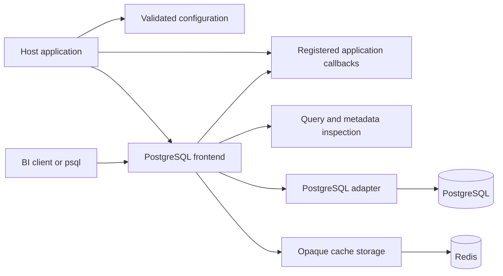
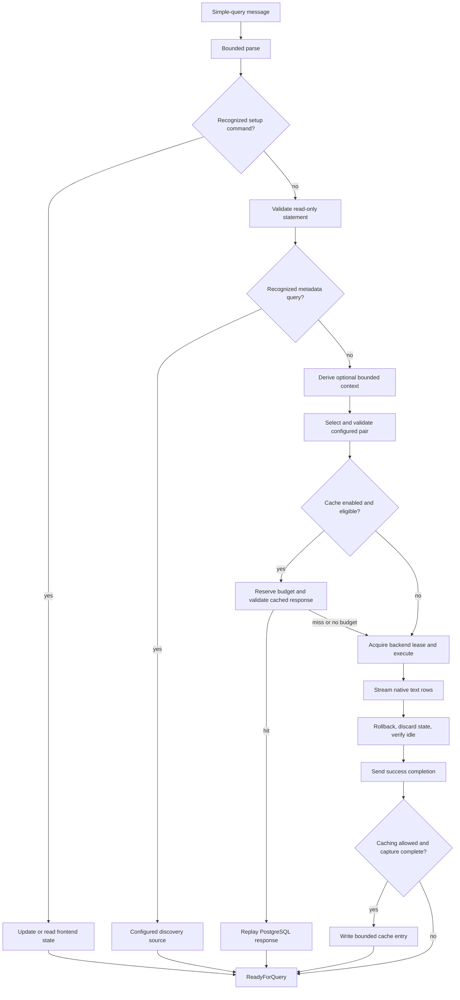

# Current architecture

YASP currently accepts loopback PostgreSQL clients and executes supported read-only
simple queries against configured PostgreSQL target/login pairs. PostgreSQL roles
enforce source access. Application-specific identity mapping and policy belong to
the consuming host. See the [plan](PLAN.md) for the multi-engine product direction.

## Component ownership

| Component | Code | Responsibility |
| --- | --- | --- |
| Host | [main.rs](../src/main.rs), [host/](../src/host) | CLI, environment resources, logging, compiled callback registration, and process lifecycle. |
| Configuration | [config.rs](../src/config.rs), [config/](../src/config) | Public facade; YAML topology/loading, settings/defaults/validation, and secret-bearing runtime configs. |
| PostgreSQL frontend | [gateway.rs](../src/gateway.rs), [gateway/](../src/gateway) | Listener and shutdown in `server`, authentication/session/cancellation in `session`, ordered stages in `query`, and route validation in `routing`. |
| SQL and metadata classification | [query.rs](../src/query.rs), [discovery.rs](../src/discovery.rs), [discovery/](../src/discovery) | Bounded immutable PostgreSQL AST; separate catalog allowlists, metadata classification, and frontend setup state. |
| Extension contracts | [hooks.rs](../src/hooks.rs), [hooks/](../src/hooks) | Separate context, selection, and cache-eligibility contracts; bounded JSON payloads and optional Python runtime, interpreter, and conversion code. |
| Backend boundary | [backend.rs](../src/backend.rs), [backend/discovery.rs](../src/backend/discovery.rs) | Public PostgreSQL exports and concrete source-engine metadata dispatch. |
| PostgreSQL adapter | [backend/postgres.rs](../src/backend/postgres.rs), [backend/postgres/](../src/backend/postgres) | Read-only execution; native connection I/O, pooling/cleanup, metadata adaptation, and cached PostgreSQL response validation. |
| Shared cache | [cache.rs](../src/cache.rs) | Bounded opaque Redis storage, expiry, connection reuse, eligibility invocation, and miss-on-error behavior. |
| Support | [transport.rs](../src/transport.rs), [logger.rs](../src/logger.rs) | Frame bounds before payload allocation and shared redacted logging setup. `policy.rs` is a future component placeholder. |



These are concrete modules within one package. Backend execution and the frontend
still use PostgreSQL message types; no generic multi-engine execution interface is
implemented. A second engine needs a deliberate supported-query/type contract,
not only another connection driver.

## Query flow



`ParsedQuery` keeps original SQL and an immutable statement tree. Supported reads
include SELECT, read-only WITH/subqueries/joins/aggregates/unions, catalog queries,
and supported SHOW requests. Application query rewrites are not implemented; the
metadata adapter does rewrite catalog SQL. Parsing has a default
1 MiB SQL limit, 4,096 significant tokens, and recursion budget 64. Unicode escaped
identifiers are unsupported. Inspection does not analyze custom function bodies;
PostgreSQL read-only transactions and source grants remain necessary.

Context runs once for each ordinary query, including cache hits. It cannot replace
authenticated frontend identity. Context errors supply an empty mapping; selector
errors stop the query; eligibility errors bypass caching. See [extensions](extensions.md).

## Discovery and frontend state

Recognized catalog reads use the configured discovery target/login, bypassing
application hooks and the result cache. The frontend classifier checks nested
relations, functions, and casts. Mixed application/catalog reads, CTE queries, and
unrecognized helpers follow ordinary routing. Source-role visibility still applies.
The PostgreSQL handler qualifies native names, limits database listings to the
source database, and applies discovery session state inside the existing read-only
transaction. The source must be reachable at startup to supply its server version.

Frontend state supports `application_name`, a discovery-only `search_path`, matching
SHOW requests, and reaffirming fixed encoding/text/read-only settings. This is not
client transaction support. Ordinary queries use the backend's normal search path;
use schema-qualified application tables. Client setup is in [configuration](configuration.md#discovery-and-client-setup).

## Sessions, cancellation, and cleanup

```mermaid
sequenceDiagram
    participant Client
    participant Session as Frontend session
    participant Adapter as PostgreSQL adapter
    participant PG as PostgreSQL
    Client->>Session: Startup and SCRAM authentication
    Session-->>Client: Backend key and ReadyForQuery
    Client->>Session: Simple query
    Session->>Adapter: Validated query and cancellation receiver
    Adapter->>PG: BEGIN READ ONLY and query
    opt Client cancels on a separate connection
        Client->>Session: CancelRequest with session key
        Session->>Adapter: Cancel active stage
        Adapter->>PG: Dedicated backend CancelRequest if executing
    end
    PG-->>Adapter: Rows, completion, or query error
    Adapter->>PG: Rollback and reset when protocol state permits
    Adapter-->>Session: Completion or error; release only a verified idle lease
    Session-->>Client: Response and ReadyForQuery
```

The gateway admits bounded extra cancel-only connections even when normal session
slots are occupied. Cancellation can stop context, selection, cache waits, or active
backend work; backend cancellation uses a separate PostgreSQL connection. A cancelled
lease is discarded, preventing a delayed cancel from reaching a future borrower.
Cancellation reports `57014` and the frontend session can continue. A disconnect
abandons its active execution; interrupted or unhealthy leases are discarded.

Reusable leases require rollback, `DISCARD ALL`, restoration of fixed settings,
idle-state verification, and a health query. Unsupported ParameterStatus changes,
unread protocol messages, cleanup failures, and cancellation prevent unsafe reuse.
Success completion follows cleanup. Shutdown stops admission, stops hook admission,
drains sessions to the configured deadline, then closes pools and cache resources.

## Values and cache ownership

PostgreSQL column metadata and text rows stream without conversion through JSON or
a Rust numeric model. NULLs, type identifiers, and text values retain their native
representation. The adapter validates text row framing and owns response capture,
cache scope, validation, and replay in `backend/postgres/cache.rs`.

Shared Redis code stores a versioned opaque payload under a namespace and normalized
SQL SHA-256 identifier. Scope also validates frontend identity/database, backend
endpoint/database/user, fixed text settings, query/write timers, and codec version.
Different scopes can replace the same SQL slot; validation prevents cross-scope
replay. Derived context does not partition cache entries.

Only complete successful results within row and byte limits are stored. Oversized
results continue streaming. Redis errors, deadlines, malformed entries, and scope
mismatches become misses. Hits do not contact PostgreSQL, so grants and row-level
security are not rechecked until expiry. Buffer accounting and cache settings are in
[configuration](configuration.md#redis-result-cache). Future policy and masking must
process both hits and misses before client output.
