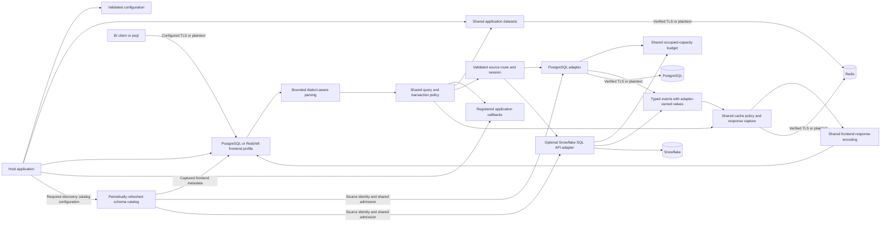
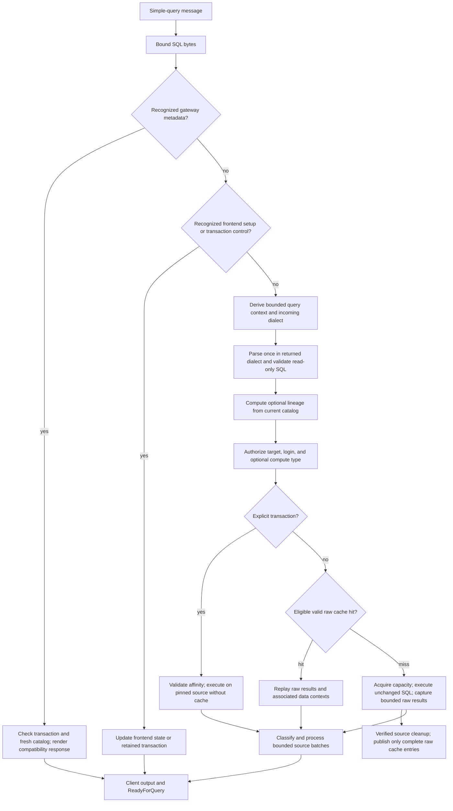
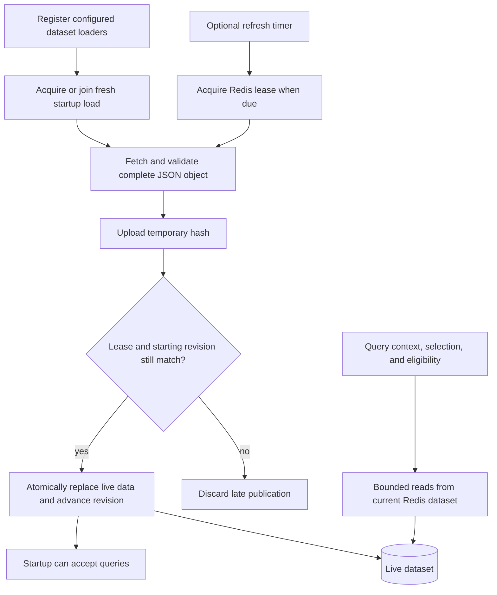
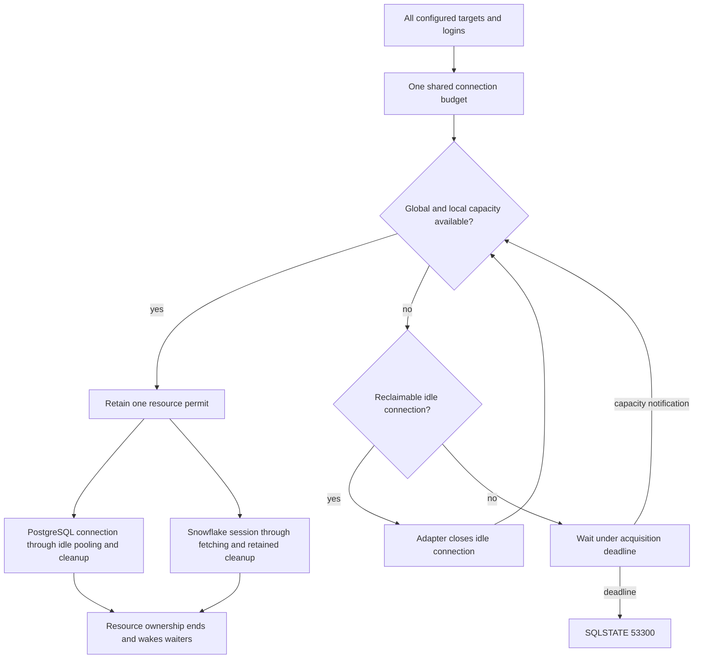
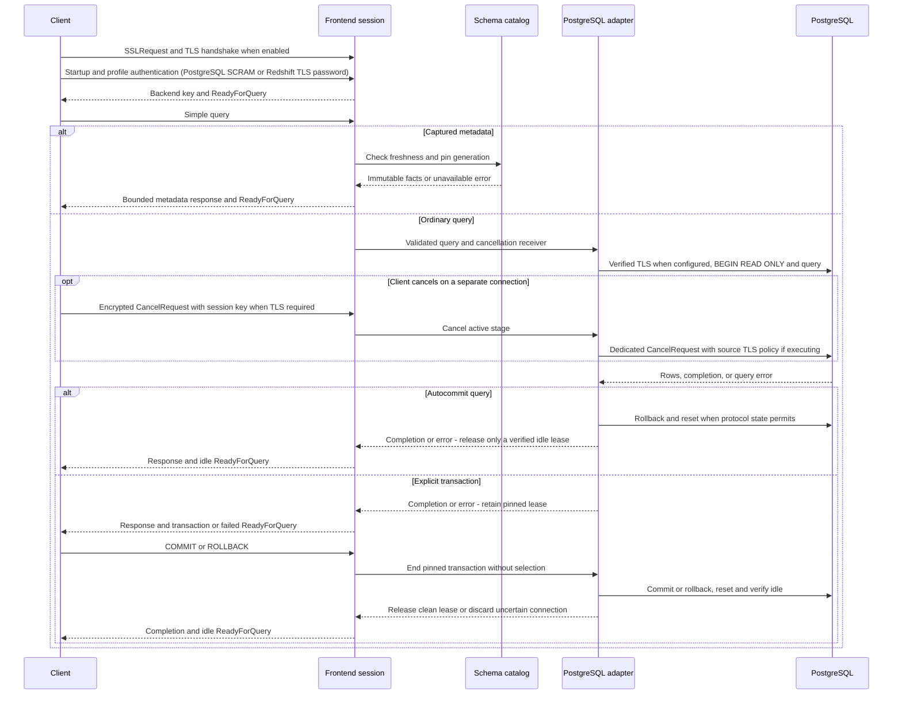

# Current architecture

YASP accepts PostgreSQL clients over independently configured TLS or plaintext connections
and offers an experimental Redshift password profile over TLS. Both execute supported read-only
simple queries against configured PostgreSQL or optional Snowflake bindings.
Source roles enforce access. Application-specific identity mapping and policy belong to
the consuming host. See the [plan](PLAN.md) for the multi-engine product direction.

## Component ownership

| Component                       | Code                                                                                                           | Responsibility                                                                                                                                                                                              |
| ------------------------------- | -------------------------------------------------------------------------------------------------------------- | ----------------------------------------------------------------------------------------------------------------------------------------------------------------------------------------------------------- |
| Host                            | [main.rs](../src/main.rs), [host/](../src/host)                                                                | CLI, environment resources, logging, compiled callback registration, and process lifecycle.                                                                                                                 |
| Configuration                   | [config.rs](../src/config.rs), [config/](../src/config)                                                        | Public facade; YAML topology/loading, settings/defaults/validation, and secret-bearing runtime configs.                                                                                                     |
| Shared pgwire frontend          | [gateway.rs](../src/gateway.rs), [gateway/](../src/gateway)                                                    | Listener/shutdown and authentication in `server`/`session`; bounded parsing in `query`; profile response and error encoding in `result`.                                                                    |
| Shared execution                | [execution.rs](../src/execution.rs), [execution/](../src/execution)                                            | Read-only validation, lineage, routing/execution stages and transaction state; typed requests, responses, and failures without wire messages or source connection objects.                                      |
| SQL and metadata classification | [query.rs](../src/query.rs), [discovery.rs](../src/discovery.rs), [discovery/](../src/discovery)               | Bounded immutable PostgreSQL, Redshift, or Snowflake AST; separate catalog allowlists, metadata classification, and frontend setup state.                                                                   |
| Extension contracts             | [hooks.rs](../src/hooks.rs), [hooks/](../src/hooks)                                                            | Separate context, selection, result-processing, cache-eligibility, and dataset-loader contracts; bounded JSON payloads and optional Python runtime, interpreter, and conversion code.                                          |
| Shared application datasets     | [datasets.rs](../src/datasets.rs)                                                                              | Startup-loaded JSON mappings shared through bounded Redis lookup helpers by context and query callbacks.                                                                                                    |
| Shared schema catalog           | [catalog.rs](../src/catalog.rs), [catalog/](../src/catalog), [gateway/metadata.rs](../src/gateway/metadata.rs) | Bounded periodic schema snapshots, source coordinates/native types, age/status, and captured frontend metadata responses. The current snapshot also supplies local output lineage.                          |
| Backend boundary                | [backend.rs](../src/backend.rs), [backend/discovery.rs](../src/backend/discovery.rs)                           | Public PostgreSQL exports; concrete route/pinned-session dispatch in `backend/execution`; typed failures/events in `backend/result`; catalog source identity in `backend/discovery`.                        |
| Backend capacity                | [backend/budget.rs](../src/backend/budget.rs)                                                                  | One occupied-capacity total, atomic local group limits, resource permits, wait notifications and adapter-owned idle reclamation.                                                                            |
| PostgreSQL adapter              | [backend/postgres.rs](../src/backend/postgres.rs), [backend/postgres/](../src/backend/postgres)                | Read-only execution; native connection I/O, pooling/cleanup, metadata adaptation, and verified completion/source identity.                                                                                  |
| Experimental Snowflake adapter  | [backend/snowflake.rs](../src/backend/snowflake.rs), [backend/snowflake/](../src/backend/snowflake)            | Optional public SQL API client, key-pair JWTs, bounded partition downloads, value conversion, autocommit transaction compatibility, and normalized schema provider. Mixed bindings use `backend::Backends`. |
| Shared cache                    | [cache.rs](../src/cache.rs), [cache/](../src/cache)                                                            | Backend-independent eligibility/capture/replay, source scope, complete frontend response validation, bounded Redis storage, expiry and miss-on-error behavior.                                              |
| Support                         | [wire.rs](../src/wire.rs), [transport.rs](../src/transport.rs), [logger.rs](../src/logger.rs)                  | Shared pgwire value encoding, frame bounds before payload allocation and redacted logging setup. `policy.rs` is a future component placeholder.                                                             |

These are concrete modules within one package. Shared orchestration and transaction
state use typed `ExecutionRequest`, `SessionRequest`, `ResultEvent`, `ExecutionError`, `Route`, and
`PinnedSession` contracts. They do not depend on PostgreSQL wire messages/errors,
source SQL, or native connection objects. The frontend owns authenticated password
and TLS material and passes only identity and bounded services into execution.

The PostgreSQL adapter owns native value/error representations, pool admission,
read-only transaction setup and source cleanup. Its response/error values pass
through the shared layer opaquely, retaining native field metadata and text without
JSON conversion. Shared frontend encoding also handles converted source events; the
engine captures that response only when caching is enabled and budget is available. Existing public PostgreSQL library entry points retain their
wire-oriented signatures. Adding another source extends the concrete dispatcher and
provides its own result/session implementation after its connector gates pass.

## Query flow

`ParsedQuery` keeps original SQL, its incoming dialect, and an immutable AST.
Metadata recognition uses the gateway grammar before query context, regardless of
any native remark. Frontend setup, fingerprints, and transaction controls bypass
context. Ordinary queries derive context exactly once, including cache hits, then
parse using its dialect (or the gateway default). Hook errors reject the query.
The raw context request has no AST, lineage, or final query ID; downstream selection,
eligibility, and result hooks receive the parsed AST and `query_context` values.

Optional `data_contexts.ast.enabled` computes lineage from the current catalog after
query context and before routing. Missing facts remain explicit unknowns. Parsing
has byte, 4,096-token, and recursion bounds; Unicode escaped identifiers remain
unsupported. Source grants and read-only transactions remain necessary.

Current execution forwards accepted SQL unchanged. The planned application modifier
runs after parsing and revalidates its output. Future target-specific translation
runs after selection whenever the incoming dialect differs from the target's;
revalidate effective SQL, recompute lineage and query ID before cache eligibility.
See [SQL translation](multi-engine.md#planned-sql-translation).

The host loads registered application datasets before it serves clients. Rust and
Python callbacks receive an optional `DatasetReader`; each lookup reads the latest
Redis value and is bounded by configured byte and field limits. Startup load failures
prevent service. Scheduled refreshes retain the last successful values while a new
load runs and leave them in place after a failed refresh. Dataset storage uses a Redis
namespace separate from the result cache; see [configuration](configuration.md#shared-application-datasets).

The timer is absent when every refresh interval is zero. Refresh errors leave the
live dataset available. Staging keys expire; live data has no TTL. The library does
not provide manual refresh or invalidation controls in this phase.

## Compute and connection ownership

A target can expose optional compute types with ordered physical instances. The
application selector returns the source/login and optional type; overflow is
engine-owned and never changes those decisions. Login-specific pools preserve
source authentication while instance limits cover all logins together.

One `backend::ConnectionBudget` covers every adapter in a configured registry.
It atomically checks the total and the allocation group's local ceiling. PostgreSQL
connections retain their permits through creation, use, cleanup and idle pooling.
Snowflake sessions retain theirs through fetching, frontend transaction blocks and
abandoned-operation cleanup. Permits are released only when their resource ownership
ends; an HTTP transport socket is not an admitted Snowflake session.

PostgreSQL registers weak idle-pool reclamation callbacks with the common budget.
A blocked Snowflake binding can reclaim an idle PostgreSQL connection. Callbacks
run outside accounting locks; active resources are never reclaimed. Returning a
PostgreSQL lease to idle wakes waiters even though its physical permit stays held.

Queries wait asynchronously under one `backend.acquire_timeout_ms` deadline, then
receive `53300`. Closing a binding stops its waiters without releasing active or
cleanup permits or closing unrelated bindings. Session limits bound waiting queries;
Redis query queuing is future work. Cache replay and snapshot metadata responses
acquire no capacity; catalog refreshes share normal source admission.

## Discovery and frontend state

The required [shared catalog](catalog.md) imports bounded PostgreSQL or Snowflake
schema definitions and periodically publishes immutable generations. Captured JDBC,
Metabase, Redash and SQLAlchemy requests use frontend-specific snapshot responses
before general parsing. The YAML host requires `schema_discovery.catalog` with an
explicit schema scope. Library serving entry points require a loaded catalog matching
the configured discovery source identity.

Providers own native metadata SQL and source-specific facts. PostgreSQL collects a
consistent generation in one admitted read-only repeatable-read transaction; it
retains native identifiers, owners, ACLs, keys, views, indexes, types and identity
options. Snowflake retains normalized facts and stable virtual frontend identifiers.
Shared catalog code owns bounds, immutable publication, refresh, expiry and status.
Frontend metadata modules recognize reviewed statement templates and encode the
client response. The source version is captured during loading, without a separate
listener-startup source lookup.

Recognized metadata uses snapshot handling regardless of native remarks or hook
output. Metadata responses pin a generation and acquire
no backend session or application context, selection or result-cache hooks.
Unsupported classified metadata returns `0A000` for either engine. Expired snapshots
return `55000`; neither failure triggers live discovery. Failed frontend transactions
reject metadata until rollback. The conservative AST classifier remains responsible
for keeping unsupported catalog requests away from application routing. Mixed
application/catalog reads and unrecognized helpers retain ordinary routing and its
source-role authorization. Snapshot metadata is not an authorization policy and does
not resolve lineage or apply masks.

Frontend state supports bounded `application_name` and `search_path`, matching SHOW
requests, and reaffirming fixed encoding/text/read-only settings. Ordinary execution
replays these settings; snapshot schema probes resolve the scoped frontend search path. Explicit transactions retain their
initial frontend settings for rollback; commit preserves supported changes.
Autocommit cache scope includes these settings. Client setup is in
[configuration](configuration.md#discovery-and-client-setup).

`BEGIN` records a pending read-only, read-committed transaction without selecting a
backend. The first backend operation pins its actual physical connection. Each
ordinary statement still runs context and selection; its route must permit that
connection. Snapshot discovery retains its configured source identity and does not
create or change a physical transaction pin. Transaction controls need no context or fresh selection. Explicit
transactions bypass cache reads and writes. Errors produce failed transaction
status until rollback; commit in failed state rolls back.

## Sessions, cancellation, and cleanup

TLS material loads before session admission. Frame bounds apply to decrypted
PostgreSQL messages. A bounded TLS bridge observes decrypted Terminate messages,
TLS closure, and EOF while a query executes. TLS negotiation shares the startup
deadline; no verification failure falls back to plaintext. See [TLS setup](tls.md).

The gateway admits bounded extra cancel-only connections even when normal session
slots are occupied. Cancellation can stop context, selection, cache waits, or active
backend work; PostgreSQL cancellation uses a separate source connection. Snowflake
uses best-effort SQL API cancellation for known handles and retains admission
through cleanup or the submitted server timeout when the handle is unavailable. A cancelled PostgreSQL
lease is discarded, preventing a delayed cancel from reaching a future borrower.
Cancellation reports `57014`; explicit transactions require rollback before further
queries. The message-read deadline bounds idle and partial-message transactions,
including pending transactions. A disconnect
abandons its active execution; interrupted or unhealthy leases are discarded.

Reusable leases require rollback, `DISCARD ALL`, restoration of fixed settings,
idle-state verification, and a health query. Unsupported ParameterStatus changes,
unread protocol messages, cleanup failures, and cancellation prevent unsafe reuse.
PostgreSQL success completion follows cleanup. Shutdown stops admission, stops hook admission,
drains sessions to the configured deadline, then closes pools and cache resources.

Snowflake bindings submit fixed identity, role, warehouse and output settings on
every SQL API request. Frontend transactions pin a route and preserve failure
states, while each source statement autocommits without a shared snapshot.
Responses download sequentially within a decompressed byte bound. Interrupted
operations retain admission during bounded cleanup; no mutable backend session is
reused. Supported values and remaining acceptance gates are documented in
[multi-engine compatibility](multi-engine.md).

## Values and cache ownership

PostgreSQL column metadata and text rows stream without conversion through JSON or
a Rust numeric model. NULLs, type identifiers, and text values retain their native
representation. The adapter validates text row framing. `wire.rs` encodes both
frontend profiles; `cache/execution.rs` owns cache policy/scope and
`cache/response.rs` captures, validates and replays the complete frontend response
for every backend. Adapters supply source identity and verified completion, with
no per-backend cache switch.

Shared Redis code stores a versioned opaque payload under a namespace and normalized
SQL SHA-256 identifier together with configured target/login names. Separate named
pairs retain separate entries. Scope also validates frontend identity/database,
frontend profile and input dialect/mode, compute instance, backend
endpoint/database/principal, Snowflake role/warehouse/schema, fixed text settings,
effective search path/application name, query/write timers, frame bound and
codec/execution revision. Overflow fills record the actual physical source.
Different physical scopes within a named pair can
replace its SQL slot; validation prevents cross-scope replay. Derived context does
not partition cache entries.

Only complete successful results within row and byte limits are stored. Oversized
results continue streaming. Redis errors, deadlines, malformed entries, and scope
mismatches become misses. Hits do not contact the backend, so grants and row-level
security are not rechecked until expiry. Buffer accounting and cache settings are in
[configuration](configuration.md#redis-result-cache). Future policy and masking must
process both hits and misses before client output.

## Optional result classification

`decision_model` owns the bounded REST contract and typed probability/confidence
outcomes. `execution/classification.rs` pauses data-row output while collecting
one bounded prefix and classifying each column. Backend execution and cleanup
remain adapter-owned. Transactions use the same stage without Redis. The cache
captures raw frames before this gate, associates complete raw entries with
bounded column sidecars, and loads those sidecars on hits without inference.
Optional result callbacks run after classification on misses and raw cache replay.
No dynamic masking runs. See [result processing](result-processing.md) and [result classification](decision-model.md)
for bounds, failure defaults, library registration, and the processing flow.

The YAML host groups output context sources under `data_contexts`, with the active
classifier configured at `data_contexts.decision_model` and local lineage at
`data_contexts.ast`. Dictionary matching and dynamic masking remain
separate capabilities; no classification is inferred from lineage alone.
