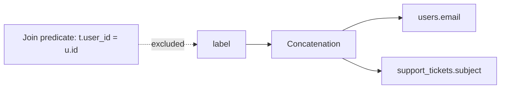
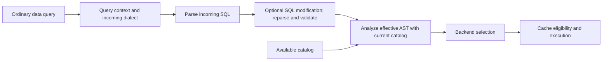

# AST output lineage

YASP can report which source columns contribute to each output column in a query.
It parses SQL locally with its existing `sqlparser` AST and resolves column
references using the catalog currently available to the gateway. It does not query
the target database for lineage.

## Enable lineage

```yaml
data_contexts:
  ast:
    enabled: true
    namespace: "yasp:ast_cache"
```

Lineage is disabled by default. The parsing dialect comes from query context,
falling back to the gateway; lineage settings do not select a grammar.

Library applications can configure the same setting with
`GatewayConfig::with_ast_context(AstSettings { ... })`.

## How to read the result

An abstract syntax tree (AST) represents SQL as nested expressions. For example:

```sql
SELECT u.email || ':' || t.subject AS label
FROM users u
JOIN support_tickets t ON t.user_id = u.id;
```



The output lineage contains `users.email` and
`support_tickets.subject`. The join key does not contribute to the value
of `label`.

`data_contexts.ast.columns` is ordered by output position. Each record has a
zero-based `ordinal`, an optional output `name`, and deduplicated `sources`.
Repeated output names stay separate because their positions differ.

```json
{
  "columns": [
    {
      "ordinal": 0,
      "name": "email",
      "sources": [
        {
          "column": "\"analytics\".\"public\".\"users\".\"profile\"",
          "path": ["contact", "email"]
        }
      ]
    }
  ]
}
```

Column names quote each database, schema, relation, and column component so
embedded dots or quotes remain unambiguous. Unresolved inputs are kept alongside
known sources. For example, if `id` resolves but `date` is absent from the catalog,
`CONCAT(id, date)` includes the known `id` source and
`{"unknown":"date"}`.

## Lineage rules

| Query expression                                     | Reported sources                                                                          |
| ---------------------------------------------------- | ----------------------------------------------------------------------------------------- |
| A column, alias, or cast                             | Its underlying source columns.                                                            |
| Operators and ordinary function calls                | The union of their value arguments.                                                       |
| `COUNT(*)`                                           | No source columns. This exception applies only to this expression.                        |
| `ARRAY_AGG(OBJECT_CONSTRUCT(*))`                     | The expanded columns inside the wildcard.                                                 |
| `CASE WHEN ... THEN a ELSE b END`                    | Sources of `a` and `b`; conditions are excluded.                                          |
| `MAX(t.subject)`                                     | `t.subject`.                                                                              |
| A window expression                                  | Function arguments; partition, order, frame, and filter inputs are excluded.              |
| CTEs, derived tables, scalar subqueries, and `UNION` | Follow referenced outputs, matching set-operation columns by position.                    |
| `SELECT *` and `t.*`                                 | Expand visible columns in catalog order, including merged `USING`/`NATURAL` join columns. |

Join predicates, `WHERE`, `HAVING`, `QUALIFY`, grouping-only references, and
ordering-only references are not output constituents. Views and generated columns
are treated as catalog column boundaries. Function bodies are not inspected, so a
function contributes its visible arguments only.

For constructed objects, lineage remains a conservative union of the inputs. If a
query builds an object from `email` and `id` and later extracts one field, the
result still contains both source columns.

## JSON paths

Direct JSON extraction composes paths through aliases and CTEs. For example,
`users.profile:contact` followed by `contact:email` resolves to
`users.profile` with path `["contact", "email"]`. PostgreSQL `->`, `->>`,
`#>`, and `#>>`, Snowflake colon paths and supported `GET`/`GET_PATH` cases, and
Redshift SUPER navigation have dialect-specific handling.

Literal keys and indices are preserved. A dynamic key adds its own visible column
sources and an unknown path step. PostgreSQL JSON array-element functions and
common Snowflake `FLATTEN` value traversal are supported; unsupported generator
shapes retain uncertainty.

## Hooks and uncertainty



Analysis is local and runs after query modification, before selection, eligibility,
and result hooks. Those Rust hooks borrow the effective query and `DataContexts`; Python hooks receive
`query_ast` and `data_contexts`. The AST JSON follows `sqlparser`'s Serde format,
so its shape depends on the parser version. The query-context callback runs before
ordinary SQL parsing and does not receive an AST or lineage.
The modification callback receives the incoming AST without lineage or data
contexts; replacements get a new AST before this analysis runs.

If a reference cannot be resolved, its source is represented as unknown. Missing
catalog facts do not make an otherwise executable query fail. Analysis has depth,
work, column, and payload limits; reaching a limit produces explicit uncertainty.

If a wildcard or unsupported relation makes the output width unknowable,
`unknown_outputs` is set and no positions are invented after the known projection
prefix. When result-column names are available, YASP aligns the context to those
columns and marks unmatched outputs unknown.

## Cache metadata

Lineage is computed from the current catalog for each query, including result-cache
hits. When result caching is enabled, a complete cache fill can store lineage beside
the raw result using the same association and expiry. `data_contexts.ast.namespace`
(default `yasp:ast_cache`) names this Redis sidecar. It uses the result cache's Redis
connection and TTL. The stored copy associates metadata with a cached result; it
does not replace current analysis.

Lineage can be enabled without Redis when result caching is disabled. The result
contains source lineage only; it does not include dictionary classifications,
RBAC decisions, or masking policy.
