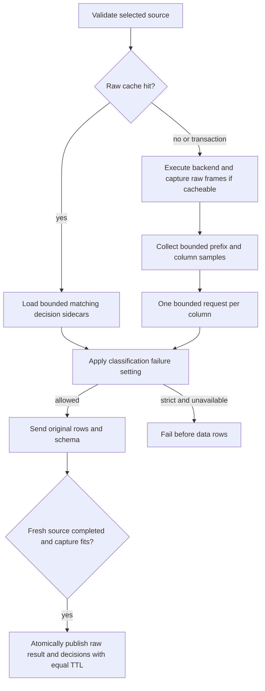

# Result classification

The optional System 1 REST client classifies output columns before data rows reach
the client. It supports every backend through shared execution. It returns
probabilities and confidence; it does not mask values, interpret authorization,
choose thresholds, or run result modification hooks.

## Configuration

The top-level `data_contexts` group configures sources of context about query output.
Omit `data_contexts.decision_model` to disable classification:

```yaml
data_contexts:
  decision_model:
    endpoint: http://127.0.0.1:8001/v1/systemone
    sample_size: 5
    timeout_ms: 2000
    fail_on_error: false
    # Optional: environment values contain the complete header, including Bearer.
    # headers_env:
    #   Authorization: YASP_MODEL_AUTHORIZATION
    questions:
      email: "Do these values contain email addresses?"
      phone: "Do these values contain telephone numbers?"
```

AST parsing with a preset dictionary is a planned second source under
`data_contexts`; it has no accepted configuration yet. Future result-processing
hooks will receive both model classification and AST dictionary context as named
data contexts. These describe output data independently of application context
and authenticated identity. AST context generation and result hooks are not
implemented in this stage.

The host resolves header values from environment variables or `.env`, using its
normal secret precedence. Missing secrets, invalid HTTP headers/endpoints, empty
questions, and invalid limits fail startup. HTTP and HTTPS are supported; redirects
are disabled. Runtime availability is checked only when making requests. Endpoint
URLs must not contain credentials. Use headers for authentication.

`sample_size` defaults to 5 and accepts 1–100. `timeout_ms` defaults to 2,000 and
bounds the whole inference stage, including admission and response reads. At most
eight HTTP requests run concurrently across the process. Model waiting has its
own deadline; actual frontend writes retain `gateway.write_timeout_ms`. Requests and responses
each have a 64 KiB limit; retained decision metadata has a 256 KiB limit. Question
definitions must fit 32 KiB. Oversized input is unavailable, never silently truncated.

By default, failed, timed out, invalid, truncated, or oversized decisions are
unavailable and database results are returned unchanged. `fail_on_error: true`
requires valid answers for every column and fails with `XX000` before emitting any
data rows. Cancellation remains `57014`. Successful decisions survive failures in
other columns. Missing decision entries also mean unavailable, never “no”.

Parallel dashboard queries or a query with many output columns can exhaust the
model service's concurrency limit, causing HTTP 503 responses. Waiting for model
capacity can also exhaust the query-wide inference deadline. Affected columns,
possibly every column of a query, become unavailable under the failure policy
above. Requests are per column, not per row. Raising the service's admission limit
(for example, `LAYA_MAX_CONCURRENT=64` for local Laya) can accommodate larger
bursts; further overload handling is planned for
[Phase 3](deliverables.md#phase-3--advanced-analytics-and-integrations).

## Sampling and API

The first chunk is a common prefix of at most 100 rows or 256 KiB of response
frames. Collection stops sooner once every column has enough non-null samples, or
at completion. Names are paired with zero-based ordinals so repeated aliases stay
distinct. Samples retain row order and duplicate values. Later chunks never extend
the sample; sparse and empty results can therefore produce empty sample arrays.

Only complete text values are sampled. A row crossing the prefix byte limit is
excluded from sampling and held only until classification finishes. The incoming
frame remains bounded by existing adapter/frame limits. Notices before column
metadata may pass through immediately; data rows wait for classification. Output
values and schema are unchanged. Explicit transaction queries are classified on
every execution but continue to bypass Redis. Discovery, setup, and locally handled
control responses bypass classification.

Each column gets a separate `POST` containing every configured question:

```json
{
  "state": {
    "sql": "SELECT email FROM users",
    "column": { "ordinal": 0, "name": "email", "data_type": "pgwire:25:-1" },
    "samples": ["alice@example.com", "bob@example.org"]
  },
  "questions": {
    "email": {
      "type": "noul",
      "instructions": "Do these values contain email addresses?"
    }
  }
}
```

SQL is formatted from the effective query's existing AST. Backend SQL and query IDs
remain unchanged. `data_type` describes the lossless frontend text type, including
its modifier; it is not database lineage. Dates, decimals, binary text, arrays, and
other values remain strings, without numeric/JSON coercion.

The response's `answers.<question>.noul` becomes `value`; `confidence` is retained.
Both must be finite numbers in [0, 1]. Every configured question must have a `noul`
answer. Confidence can be high when the answer is probably no. No thresholds or
masking decisions are inferred. The service must accept this System 1 shape; there
is no provider SDK or configurable request templating.

## Cache and ownership

Raw results keep their existing keys and unmodified values. Classified entries use
a versioned header with an association ID. Column JSON sidecars are stored at:

```text
yasp:decision_cache:<escaped-target>_<escaped-login>:<query-id>:<ordinal>:<escaped-column-name>
```

Percent signs, colons, and underscores in components are escaped. Sidecars include
version, association, configuration fingerprint, column identity, and an available
answer map or unavailable status. The fingerprint includes endpoint, questions,
and sampling rules. Sidecars share the raw result's Redis connection and TTL and
are published in one atomic command after successful complete execution. Their
serialization and bounded reads count against cache reservations. Oversized or
incomplete fills publish nothing. There is no separate classification cache TTL.

A raw cache hit never calls the model. Valid matching sidecars are reused. Missing,
malformed, mismatched, or legacy metadata becomes unavailable and follows the
configured failure policy. Reads do not extend either TTL. Model replacement at an
unchanged endpoint takes effect as raw cache entries expire or are cleared.
Decisions are not reused independently when raw data is uncached. Unavailable
outcomes stored with a raw entry are also reused until expiry; cache hits do not
retry classification after a service overload.



Library hosts construct `decision_model::DecisionModel::new(settings, headers)`
with resolved header values, then attach an `Arc` with
`GatewayConfig::with_decision_model`. Public `ColumnRequest`, `ColumnIdentity`,
`DecisionAnswer`, `ClassificationOutcome`, and `Classifications` describe the
classification boundary. `DecisionModel::classify` is also usable directly. The
execution stage retains query classifications alongside the result for caching;
result-hook registration and masking contracts remain future work.

## Development and training

Use the [local Laya server](../dev/decision-model/README.md) for manual checks.
Automated tests use deterministic HTTP mocks, never a running model or weights.
SQL, samples, authentication headers, and model response bodies are not logged by
the classification component.

Laya supports domain fine-tuning with labeled examples. Pair representative SQL
and column samples with positive and negative answers, evaluate on held-out data,
and serve the resulting checkpoint with `LAYA_MODEL`. Training and model-quality
evaluation belong outside YASP; see [Laya fine-tuning](https://github.com/NandhaKishorM/laya#fine-tuning).
