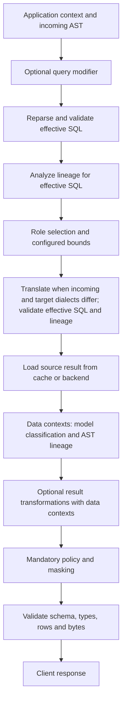

# Extension boundaries

A consuming application depends on `yasp`, resolves secrets and policy at startup,
registers callbacks, constructs backend pools and gateway configuration, then calls
`gateway::serve_routed`. `gateway::serve` supports a fixed PostgreSQL backend through
the same session handling. Custom compiled code belongs to that application or its
own crate; external Python files are deployment resources. Core modules invoke
contracts and validate decisions without interpreting organization policy. Shared
execution receives authenticated identity and bounded services; source driver and
frontend password/TLS objects remain in their adapters.

Hosts must construct a shared [schema catalog](catalog.md), attach it with
`GatewayConfig::with_catalog`. AST analysis borrows its current snapshot only
while resolving constituents; callers do not retain a generation across execution.
Catalog source identity and refresh settings belong to the host; core owns bounded
loading, atomic publication, expiry and frontend response handling. Schema coordinates
are facts, not an authorization or masking decision.
The repository host attaches the PostgreSQL or Snowflake provider through
`schema_discovery.catalog`, sharing its configured discovery identity and adapter
capacity. Mixed or Snowflake-only hosts register bindings in `backend::Backends`
and use `gateway::serve_backends`.

For encrypted deployments, see [TLS setup](tls.md#library-applications) and the
[standalone library example](../examples/tls_gateway.rs). The application owns
certificate provisioning and paths; core owns negotiation and verification.

## Implemented callback stages

Query-hook names remain under [yasp::hooks](../src/hooks.rs); dataset APIs are under
[yasp::datasets](../src/datasets.rs). Private modules own each stage's contract.
Reusable repository callbacks are under [hooks/builtin](../hooks/builtin),
and Python examples are under [hooks/examples](../hooks/examples).

| Stage              | Binding and data                                                                                                                                           | Result/failure policy                                                                                                                                                                           |
| ------------------ | ---------------------------------------------------------------------------------------------------------------------------------------------------------- | ----------------------------------------------------------------------------------------------------------------------------------------------------------------------------------------------- |
| Query context      | `bind_query_context(state, f)` / `with_query_context_hook`; byte-bounded raw SQL, frontend identity, gateway and optional common target dialect, datasets. | `QueryContextOutput { dialect, values }`; errors reject the query. No AST, lineage, or final query ID is available yet.                                                                         |
| Query modification | `bind_modify_query(state, f)` / `with_query_modification_hook`; incoming SQL and AST, dialect, identity, query context, datasets.                          | Optional replacement SQL; reparse and validate before IDs, lineage, routing, and caching. Errors reject without fallback. No lineage or data contexts in the request.                           |
| Selection          | `bind_select_backend` or `bind_select_backend_async`; borrowed `SelectionRequest` with frontend user, IDs, parsed query, and derived context.              | Partial `BackendDecision` (or an explicit pair convertible into it); invalid/ambiguous selection is `42501`, failure is `XX000`. The engine resolves configured defaults and allocates compute. |
| Cache eligibility  | `bind_cache_eligibility` or `bind_cache_eligibility_async`; the same selection request.                                                                    | Boolean that may bypass caching; errors bypass without failing execution. Cannot expand SQL or resource limits.                                                                                 |
| Dataset loading    | `bind_dataset_loader(state, f)`; async `DatasetLoadRequest` with dataset name and `startup` or `scheduled` reason.                                         | JSON object loaded before service starts and published to the shared dataset registry. Startup failure prevents serving; refresh failure preserves the previous value.                          |

Library hosts can create `backend::ConnectionBudget::new(total)` and pass it to
`PostgresBackend::with_budget`, `PostgresBackends::with_bindings_and_budget`, or an
empty `Backends::with_budget` registry. Supplied PostgreSQL registry settings must
name the same total. Existing PostgreSQL constructors allocate a standalone budget;
`Backends::new(postgres)` adopts that registry's budget, while `without_postgres()`
uses the default total. `with_snowflake` automatically attaches an unused adapter.
Register bindings before issuing catalog or data requests. Reusing an adapter under
the same budget is valid; moving it between budgets is rejected, even when idle.
Standalone Snowflake use establishes its own budget on first admission. The YAML
host supplies one configured budget before loading metadata or accepting clients.

The router resolves and validates every selection, including cache hits, and delegates execution; the backend owns
credentials and connection acquisition. Callbacks receive no backend passwords or
driver objects. Authenticated frontend identity stays separate from derived context.
SQL comments are untrusted hints;
BI viewer identity and role policy require an application-defined trust contract.

When datasets are configured, context, modification, selection, and eligibility requests also
provide an optional `DatasetReader`. `get(name, key)` reads one field,
`get_many(name, keys)` reads up to 64 fields, and `read(name)` reads the complete
dataset within the same limits. Missing fields are omitted from `get_many`;
`get` returns `None` for a missing field. Unknown dataset names and unavailable,
malformed, or oversized data return typed errors. Each lookup reads current Redis
data. A callback's reader expires when that callback completes or is cancelled.
See [shared application datasets](configuration.md#shared-application-datasets).

Rust state/functions must meet the binder's `Send + Sync + 'static` requirements.
Synchronous selection and eligibility must be fast and nonblocking.
Use `bind_select_backend_async` or `bind_cache_eligibility_async` for asynchronous
dataset reads; `gateway.async_hook_timeout_ms` bounds these waits.
`hooks.query_context` runs once after frontend metadata/setup recognition and before
ordinary SQL parsing, including on cache hits. Metadata recognition always uses the
gateway profile and is independent of remarks or hook output. A recognized request
does not invoke query context, modification, selection, eligibility, or result processing.

The hook returns `{"dialect": "postgresql", "values": {"user_id": 7}}`. Both fields
are optional: the dialect defaults to the gateway and values to an empty object.
Supported dialects are `postgresql`, `redshift`, and `snowflake`. The dialect is the
grammar of incoming SQL; it selects no target, login, or compute. Hook failures,
invalid output, size/nesting violations, and timeouts reject the query with `XX000`;
cancellation reports `57014`. Authenticated identity remains engine-owned.

```yaml
hooks:
  query_context:
    type: rust
    callback: builtin.query_context.metabase
```

Params are optional. Metabase MBQL/UI exploration and absent/malformed/unknown
remarks use the gateway dialect. Explicit native remarks use `params.native_dialect`
when supplied, otherwise the common dialect of configured targets. Multiple logins
and compute instances do not affect inference. Mixed target dialects require an
explicit native dialect or a custom hook; inference never uses the discovery target.

`builtin.query_context.redash` extracts saved, `adhoc`, and scheduled query remarks.
Redash has no native/generated or dialect field, so its default is the gateway.
Optional `params.dialect` overrides the dialect for a valid Redash remark; missing
or malformed remarks retain the gateway default.

```yaml
hooks:
  query_context:
    type: rust
    callback: builtin.query_context.redash
    params:
      dialect: postgresql # Optional: Redash SQL written for PostgreSQL.
```

Superset remark formats and any other custom BI metadata belong to application
hooks. No default Superset parser is registered. Custom Rust/Python providers use
the same `dialect`/`values` output contract. Successful empty output `{}` uses defaults;
errors do not silently fall back. Downstream hooks read application values through
`request.query_context` in Rust or `request["query_context"]` in Python.

Rust providers return `QueryContextOutput`; its optional `dialect` defaults to the
gateway and `values` is an owned `serde_json::Map`. A values-only Rust provider may
return `values.into()`. Use cooperative async I/O: deadlines cannot interrupt
blocking Rust. Raw request fields are `authenticated_user`, `frontend_database`,
`client_id`, `sql`, `gateway_dialect`, and `default_target_dialect`; Python receives
their JSON equivalents plus an invocation-scoped dataset helper when configured.

```python
def query_context(request, params):
    # Parse the application's configured Superset/custom remark format here.
    return {"dialect": "postgresql", "values": {"user_id": 7}}
```

Modification receives the incoming parsed AST without lineage. Selection,
eligibility, and result hooks receive the effective AST and downstream data
contexts. A future translator compares the returned incoming dialect with
the selected target dialect; see [planned translation](multi-engine.md#planned-sql-translation).

## Query modification

`bind_modify_query(state, f)` binds an async Rust callback returning
`Result<Option<String>, QueryModificationError>`. Python uses
`modify_query(request, params)` returning a SQL string or `None`. Register it with
`GatewayConfig::with_query_modification_hook` or `hooks.modify_query`.

The request contains original SQL, its parsed AST (`statement` in Rust,
`query_ast` in Python), the resolved/gateway/common target dialects, authenticated
frontend identity/database, client ID, derived query context, and scoped datasets.
It has no query ID, selected backend, lineage, or `data_contexts`. Replacement SQL
is reparsed and validated in the resolved dialect; downstream lineage, selection,
cache eligibility, and execution consume the effective query. No change preserves
the original bytes. Failures reject the query without fallback.

The hook runs once per ordinary query, including cache hits and transaction source
queries. `gateway.async_hook_timeout_ms` and existing Python bounds apply.
See [query modification](query-modification.md) for configuration, errors, and
table/subquery/filter examples.

## Result processing

Use `bind_process_result(state, f)` and `GatewayConfig::with_result_hook` for bounded
async Rust callbacks, or a registered Python callback with the native batch object.
The result request includes immutable identity, selected target/login, application
context, scoped dataset access, and raw output AST/model data contexts. The callback
may edit text, set NULL, and filter rows while preserving schema and retained-row
order. Failures deny the affected query; no raw fallback runs. The same processing
stage runs after raw cache capture and on replay. See [the contract and examples](result-processing.md).

## Owning shared datasets

Keep a `Datasets` value alive while serving. Register one `DatasetLoader` for each
configured name, then await `Datasets::start(settings, redis_url, loaders)` before
opening the listener. It requires a fresh successful load for every name, including
names already present in Redis. Pass `datasets.reader()` through
`GatewayConfig::with_datasets`; call `datasets.shutdown().await` after serving,
including when serving fails. Dropping the owner cancels its refresh admission.

Compiled loaders use `datasets::bind_dataset_loader(state, function)` and return
an owned `serde_json::Map<String, Value>`. Request `name` identifies the dataset;
`reason` is `startup` or `scheduled`. The engine owns storage and bounds; loaders
own fetching and data meaning. The supplied host provides
[`builtin.dataset.load_json`](../hooks/builtin/dataset.rs) for small JSON files;
[the Rust example](../hooks/examples/datasets.rs) shows an application-owned loader
that returns data in code. Application hosts can also register Python loaders with
`PythonRuntime::register_loader`; they follow the same plain JSON contract.

For Python loaders, create the process runtime with
`PythonRuntime::new_with_dataset_limit(settings, max_dataset_bytes)` and register
them using `register_loader(path, callback, params, max_dataset_bytes, timeout)`.
The separate loader queue has capacity one and a byte budget derived from the
larger of the dataset and Python payload limits. Ordinary `PythonRuntime::new`
creates only the query worker. Both modes initialize one interpreter per process.

Each hook invocation allows 32 dataset calls. Redis operations have a 100 ms wait;
`get_many` and `read` allow at most 64 fields and one `max_lookup_bytes` response.
Read buffers have an aggregate budget of at least 32 MiB, reserving three times the
lookup limit per active read. Python lookups charge the returned bytes against the
query worker's byte budget until its job finishes, including after a waiting
timeout. Each invocation also has a cumulative 32-response byte ceiling.
These are serialized-data limits, not a sandbox or a bound on arbitrary callback
heap allocations. The dataset helper itself is a service object; other request
fields and lookup results are copied JSON values.

## External Python

Enable the `python` feature and create one `PythonRuntime` per process before
serving. Clone it for additional registrations. The repository host shares one
runtime among context, selection, eligibility, and result processing and resolves references in
[host/hooks.rs](../src/host/hooks.rs).

```yaml
hooks:
  select_backend:
    type: python
    path: ../hooks/examples/select_backend.py
    callback: select_backend
    params:
      target: primary
      backend_login: reader
```

Files/functions are registered before listener startup. Every trusted synchronous
function receives `function(request, params)` with fresh copied JSON-compatible
objects. Selection/eligibility requests contain `authenticated_user`, `client_id`,
`query_id`, original `sql`, `query_ast`, `data_contexts`, and `query_context`.
`query_ast` uses sqlparser 0.63 Serde syntax; `data_contexts.ast` contains optional
local output lineage. Rust requests borrow the same `DataContexts` alongside their
existing `ParsedQuery`. Python receives fresh copies, so callback mutations cannot
change later hooks. AST lineage performs no dictionary lookup or classification.
See [AST lineage](ast-lineage.md). Query-context input uses the raw request described above and contains no AST, lineage, or final query ID. Selection returns exactly
a dictionary with optional `target`, `backend_login`, and `compute_type` keys,
or `None` to deny; query context returns the `dialect`/`values` envelope; eligibility returns a boolean.

The boundary accepts exact built-in null/bool/string/list/string-keyed dictionary,
signed/unsigned 64-bit integers, and finite float values, with nesting limited to 64. It is not a database value codec. Unsupported values/coroutines fail. Python
errors are redacted; callbacks remain responsible for their own logs and side effects.

One dedicated worker runs registration and invocation outside Tokio. Defaults admit
32 waiting jobs, a 4 MiB queued-plus-active input budget, 2 MiB individual payloads,
and a 2-second wait including queue time/registration. Executing timed-out or
abandoned Python retains its worker and byte reservation until it finishes; expired
queued jobs do not run. Shutdown stops admission and wakes waiters without joining
executing code. Embedded Python is trusted code, not a sandbox or hard-kill boundary.
All hooks share imports, package versions, interpreter state, and the CPython GIL.
See [interpreter/package setup](development.md#python-embedding).

For dataset-aware Python callbacks, `request["datasets"]` exposes synchronous
`get(name, key)`, `get_many(name, keys)`, and `read(name)` helpers. They return normal
Python JSON values, not encoded JSON strings, and do not keep an expiring process-local
copy. Dataset loaders use a dedicated worker but share the callback interpreter and
GIL. Existing `PythonCallback::call(request)` remains available; dataset-aware calls
use the optional reader. See the runnable [dataset examples](../hooks/README.md#shared-datasets).

## Planned query and result stages

Optional [REST column classification](decision-model.md) exposes typed requests and
probability/confidence outcomes through `decision_model` and
`GatewayConfig::with_decision_model`. It supplies raw outcomes to optional result callbacks and does not apply masks.
The YAML host configures it under `data_contexts.decision_model`. Result hooks receive
named model outcomes and AST lineage. Dictionary matching remains future work;
lineage performs no classification.

Lifecycle hooks, target-specific translation, and engine policy/masking remain
future work. The diagram combines implemented query modification/result callbacks
with those planned stages; see the current [query pipeline](architecture.md#query-flow):



Future stage requests should expose original/effective SQL, derived context,
engine-validated route/execution decisions and cache outcome when known, and bounded
result metadata/batches where appropriate. Before execution, callbacks may propose
supported rewrites, denial, rerouting, or cache bypass only where their stage allows;
the engine validates each proposal centrally. Later stages observe the decided flow
immutably. No stage may replace authenticated identity, exceed configured bounds,
bypass mandatory policy, or change transaction/portal decisions already pinned for
execution. These stage contracts remain future work.

Future prepared-query rewrites must preserve parameter positions/types and repeat
dialect/read-only validation. Result stages must preserve schema and ordering, use lossless native
values, and handle NULLs and duplicate column names by ordinal/metadata. Optional
transformations precede mandatory masks; later hooks cannot restore raw values.
Run policy and masking on both cache hits and misses. A partially emitted result
cannot be retracted; whole-result decisions require bounded buffering or conservative
masking before output. Mask thresholds, mandatory-mask failure policy, and policy
generations belong to that future contract. Classification already has bounded
availability and cache-association contracts. See [Phase 2](PLAN.md#phase-2--additional-engines-dynamic-masking-and-management).

## Adding capabilities when their phase is active

| Capability                                | Local ownership and required proof                                                                                                                                                                                                                                                                                                                                                                                                                                    |
| ----------------------------------------- | --------------------------------------------------------------------------------------------------------------------------------------------------------------------------------------------------------------------------------------------------------------------------------------------------------------------------------------------------------------------------------------------------------------------------------------------------------------------- |
| Another backend                           | Add its adapter for drivers, native values, pooling, session state, cancellation, and error conversion. Add concrete dispatch when needed. Define supported SQL/dialect and PostgreSQL frontend mappings, including native metadata discovery. Prove precision, NULLs, timestamps, transaction cleanup, and source-identity cache isolation before declaring support. Shared execution supplies cache policy and response encoding; adapters do not opt into caching. |
| Another client protocol or BI integration | Keep protocol framing/authentication/encoding in its frontend adapter. A warehouse driver does not provide another frontend protocol. Record real client/version/startup/discovery/query/cancel traffic; verify metadata trust, absent-context behavior, prepared/binary needs, and BI-side caching. Current extractor names are placeholders.                                                                                                                        |
| RBAC and identity mapping                 | Supply application-owned trusted context, local policy, and role mappings. Preserve configured route bounds and source grants. Current source roles enforce access; engine policy must cover cached and uncached results before output.                                                                                                                                                                                                                               |
| Query/result/lifecycle hooks              | Define only the active stage's bounded request/result/failure contract. Preserve cancellation, lossless values, schema, and resource accounting; implement stages in query order rather than a generic plugin registry.                                                                                                                                                                                                                                               |
| Load balancing                            | The engine allocates configured compute instances in overflow order within the selected type and source login. The selector chooses the type, without live pool-state logic. Least-busy and round-robin strategies, provider lifecycle, and prepared-state pinning are later milestones.                                                                                                                                                                              |
| Management or UI                          | Add an authenticated host/service boundary over supported engine operations. Authorize configuration inspection and query execution; redact secrets/results, enforce request limits, and define atomic config activation/cache invalidation. No management API or UI exists yet.                                                                                                                                                                                      |

### Observed SQL context from local BI traffic

The 2026-10-18 local capture showed these chart-query formats:

| Tool     | SQL shape observed                                                                                                                                                                                     | Context available in the captured SQL                                                                                                                                                                                                                                             |
| -------- | ------------------------------------------------------------------------------------------------------------------------------------------------------------------------------------------------------ | --------------------------------------------------------------------------------------------------------------------------------------------------------------------------------------------------------------------------------------------------------------------------------- |
| Metabase | A leading line comment, `-- Metabase:: userID: <id> queryType: <type> queryHash: <hash>`, followed by native SQL. The session also sent `SET application_name = 'Metabase v0.64.2.8 [<instance-id>]'`. | `userID`, `queryType` (observed as `native`), and `queryHash`; the application name identifies the client version and instance. Repeated runs retained the query hash.                                                                                                            |
| Redash   | A leading block comment, `/* user_id: <id>, query_id: <id>, Job ID: <uuid>, Query Hash: <hash>, Scheduled: <bool> */`, followed by SQL.                                                                | User, saved-query, job, hash, and scheduled-run fields. The capture showed `Scheduled: False`; repeated runs kept the saved-query ID and hash while changing the job ID.                                                                                                          |
| Superset | Generated SQL wraps a query as `SELECT ... FROM ( <dataset SQL> ) AS virtual_table`, often with outer grouping, ordering, or a `LIMIT 1000`.                                                           | No native user/query comment or equivalent SQL marker was visible. The test charts deliberately included a string literal such as `'Superset' AS bi_tool_name`; this is a test marker, not metadata emitted by Superset, and the outer query may omit it from its output columns. |

Treat comment fields such as `userID` and `user_id` as client-supplied hints, never as authenticated identity or authorization evidence. The SQL log records query text and execution/cache events, but does not identify whether a run came from a dashboard refresh, a chart view, a download, or an embed. The failed support-ticket join still appeared in the received SQL, so failures do not change the observed envelope. A YASP cache hit appears as a cache-served event rather than a new backend execution.

The `metabase_pg` and Redash extractors recognize the leading PostgreSQL comments
shown above. They return normalized fields including `tool`, `user_id`,
`query_hash`, and tool-specific values such as `query_type`, `query_id`, `job_id`,
or `scheduled`. Malformed or nonleading comments produce no metadata.
Redash 26.9 emits `query_id: adhoc` for an unsaved SQL-editor query. The extractor
preserves that marker as a string while retaining numeric saved-query IDs and
numeric user IDs. The same context hook therefore handles saved and unsaved runs.

Metabase's Redshift driver overrides `query->remark` to prepend a JSON `partner`
comment containing dashboard, chart, user, account, and filter metadata before the
default `Metabase::` remark. The resulting SQL remark is
`-- /* partner: "metabase", { ... } */ Metabase:: userID: ... queryType: ... queryHash: ...`.
The `metabase_rs` extractor parses that envelope and returns the partner fields
alongside the common Metabase fields. This format is implemented from Metabase's
[Redshift driver source](https://github.com/metabase/metabase/blob/master/modules/drivers/redshift/src/metabase/driver/redshift.clj#L3427-L3445);
the same envelope was observed through the YASP Redshift gateway with Metabase
v0.64.2.8.

Superset extraction is deferred: the local 6.1.0 instance had no
`SQL_QUERY_MUTATOR` configured, and its deployment-controlled mutation path has not
been verified for every query path. When DEBUG logging is enabled, PostgreSQL and Redshift
queries recognized by the gateway include `bi_remark` as the normalized object or
`null` in the `query received` event; the raw leading BI comment is omitted from
that event's `sql` field. The metadata is diagnostic only and does not affect
context or routing.

Keep PostgreSQL-specific response types and parsing inside the relevant adapters
as new implementations arrive. The present concrete APIs do not promise arbitrary
cross-engine SQL translation or PostgreSQL transparency. Add reusable traits only
when another implementation needs them, and validate each new boundary with focused
[contract scenarios](../tests/README.md) rather than internal-structure tests.
