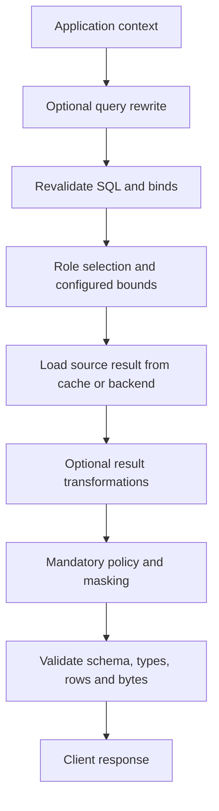

# Extension boundaries

A consuming application depends on `yasp`, resolves secrets and policy at startup,
registers callbacks, constructs backend pools and gateway configuration, then calls
`gateway::serve_routed`. `gateway::serve` supports a fixed PostgreSQL backend through
the same session handling. Custom compiled code belongs to that application or its
own crate; external Python files are deployment resources. Core modules invoke
contracts and validate decisions without interpreting organization policy.

## Implemented callback stages

Query-hook names remain under [yasp::hooks](../src/hooks.rs); dataset APIs are under
[yasp::datasets](../src/datasets.rs). Private modules own each stage's contract.
Reusable repository callbacks are under [hooks/builtin](../hooks/builtin),
and Python examples are under [hooks/examples](../hooks/examples).

| Stage | Binding and data | Result/failure policy |
| --- | --- | --- |
| Context | `bind_context(state, f)`; async borrowed `ContextRequest` with frontend identity/database, IDs, and immutable parsed query. | Owned JSON mapping; invalid/error/timeout/saturation supplies empty context. Cancellation stops the query. |
| Selection | `bind_select_backend` or `bind_select_backend_async`; borrowed `SelectionRequest` with frontend user, IDs, parsed query, and derived context. | Partial `BackendDecision` (or an explicit pair convertible into it); invalid/ambiguous selection is `42501`, failure is `XX000`. The engine resolves configured defaults and allocates compute. |
| Cache eligibility | `bind_cache_eligibility` or `bind_cache_eligibility_async`; the same selection request. | Boolean that may bypass caching; errors bypass without failing execution. Cannot expand SQL or resource limits. |
| Dataset loading | `bind_dataset_loader(state, f)`; async `DatasetLoadRequest` with dataset name and `startup` or `scheduled` reason. | JSON object loaded before service starts and published to the shared dataset registry. Startup failure prevents serving; refresh failure preserves the previous value. |

The router resolves and validates every selection, including cache hits, and delegates execution; the backend owns
credentials and connection acquisition. Callbacks receive no backend passwords or
driver objects. Authenticated frontend identity stays separate from derived context.
SQL comments are untrusted hints;
BI viewer identity and role policy require an application-defined trust contract.

When datasets are configured, context, selection, and eligibility requests also
provide an optional `DatasetReader`. `get(name, key)` reads one field,
`get_many(name, keys)` reads up to 64 fields, and `read(name)` reads the complete
dataset within the same limits. Missing fields are omitted from `get_many`;
`get` returns `None` for a missing field. Unknown dataset names and unavailable,
malformed, or oversized data return typed errors. Each lookup reads current Redis
data. A callback's reader expires when that callback completes or is cancelled.
See [shared application datasets](configuration.md#shared-application-datasets).

Rust state/functions must meet the binder's `Send + Sync + 'static` requirements.
Synchronous selection and eligibility must be fast and nonblocking.
Use `bind_select_backend_async` or `bind_cache_eligibility_async` for asynchronous
dataset reads; `gateway.async_hook_timeout_ms` bounds these waits.
Context uses cooperative async I/O; its deadline cannot interrupt blocking Rust.
See [binding examples](../hooks/README.md).

## Owning shared datasets

Keep a `Datasets` value alive while serving. Register one `DatasetLoader` for each
configured name, then await `Datasets::start(settings, redis_url, loaders)` before
opening the listener. It requires a fresh successful load for every name, including
names already present in Redis. Pass `datasets.reader()` through
`GatewayConfig::with_datasets`; call `datasets.shutdown().await` after serving,
including when serving fails. Dropping the owner cancels its refresh admission.

Compiled loaders use `datasets::bind_dataset_loader(state, function)` and return
an owned `serde_json::Map<String, Value>`. Request `name` identifies the dataset;
`reason` is `startup` or `scheduled`. The engine owns storage and bounds; loaders
own fetching and data meaning. [Rust](../hooks/examples/datasets.rs) and
[Python](../hooks/examples/datasets.py) examples load the same plain JSON contract.

For Python loaders, create the process runtime with
`PythonRuntime::new_with_dataset_limit(settings, max_dataset_bytes)` and register
them using `register_loader(path, callback, params, max_dataset_bytes, timeout)`.
The separate loader queue has capacity one and a byte budget derived from the
larger of the dataset and Python payload limits. Ordinary `PythonRuntime::new`
creates only the query worker. Both modes initialize one interpreter per process.

Each hook invocation allows 32 dataset calls. Redis operations have a 100 ms wait;
`get_many` and `read` allow at most 64 fields and one `max_lookup_bytes` response.
Read buffers have an aggregate budget of at least 32 MiB, reserving three times the
lookup limit per active read. Python lookups charge the returned bytes against the
query worker's byte budget until its job finishes, including after a waiting
timeout. Each invocation also has a cumulative 32-response byte ceiling.
These are serialized-data limits, not a sandbox or a bound on arbitrary callback
heap allocations. The dataset helper itself is a service object; other request
fields and lookup results are copied JSON values.

## External Python

Enable the `python` feature and create one `PythonRuntime` per process before
serving. Clone it for additional registrations. The repository host shares one
runtime among context, selection, and eligibility and resolves references in
[host/hooks.rs](../src/host/hooks.rs).

```yaml
hooks:
  select_backend:
    type: python
    path: ../hooks/examples/select_backend.py
    callback: select_backend
    params:
      target: primary
      backend_login: reader
```

Files/functions are registered before listener startup. Every trusted synchronous
function receives `function(request, params)` with fresh copied JSON-compatible
objects. Selection/eligibility requests contain `authenticated_user`, `client_id`,
`query_id`, original `sql`, and `context`. Context input also includes
`frontend_database` and has no derived context yet. Selection returns exactly
a dictionary with optional `target`, `backend_login`, and `compute_type` keys,
or `None` to deny; context returns a dictionary
or `None`; eligibility returns a boolean.

The boundary accepts exact built-in null/bool/string/list/string-keyed dictionary,
signed/unsigned 64-bit integers, and finite float values, with nesting limited to
64. It is not a database value codec. Unsupported values/coroutines fail. Python
errors are redacted; callbacks remain responsible for their own logs and side effects.

One dedicated worker runs registration and invocation outside Tokio. Defaults admit
32 waiting jobs, a 4 MiB queued-plus-active input budget, 2 MiB individual payloads,
and a 2-second wait including queue time/registration. Executing timed-out or
abandoned Python retains its worker and byte reservation until it finishes; expired
queued jobs do not run. Shutdown stops admission and wakes waiters without joining
executing code. Embedded Python is trusted code, not a sandbox or hard-kill boundary.
All hooks share imports, package versions, interpreter state, and the CPython GIL.
See [interpreter/package setup](development.md#python-embedding).

For dataset-aware Python callbacks, `request["datasets"]` exposes synchronous
`get(name, key)`, `get_many(name, keys)`, and `read(name)` helpers. They return normal
Python JSON values, not encoded JSON strings, and do not keep an expiring process-local
copy. Dataset loaders use a dedicated worker but share the callback interpreter and
GIL. Existing `PythonCallback::call(request)` remains available; dataset-aware calls
use the optional reader. See the runnable [dataset examples](../hooks/README.md#shared-datasets).

## Planned query and result stages

Query rewrites, result callbacks, lifecycle hooks, engine policy/masking, and model
integration have no active runtime contracts or accepted configuration yet. This is
the intended direction, not the current [query pipeline](architecture.md#query-flow):



Future stage requests should expose original/effective SQL, derived context,
engine-validated route/execution decisions and cache outcome when known, and bounded
result metadata/batches where appropriate. Before execution, callbacks may propose
supported rewrites, denial, rerouting, or cache bypass only where their stage allows;
the engine validates each proposal centrally. Later stages observe the decided flow
immutably. No stage may replace authenticated identity, exceed configured bounds,
bypass mandatory policy, or change transaction/portal decisions already pinned for
execution. These stage contracts remain future work.

Rewrites must preserve parameter positions/types and repeat dialect/read-only
validation. Result stages must preserve schema and ordering, use lossless native
values, and handle NULLs and duplicate column names by ordinal/metadata. Optional
transformations precede mandatory masks; later hooks cannot restore raw values.
Run policy and masking on both cache hits and misses. A partially emitted result
cannot be retracted; whole-result decisions require bounded buffering or conservative
masking before output. Model confidence/failure policy and cache generations belong
to that future contract. See [Phase 2](PLAN.md#phase-2--additional-engines-dynamic-masking-and-management).

## Adding capabilities when their phase is active

| Capability | Local ownership and required proof |
| --- | --- |
| Another backend | Add its adapter for drivers, native values, pooling, session state, cancellation, and error conversion. Add concrete dispatch when needed. Define supported SQL/dialect and PostgreSQL frontend mappings, including native metadata discovery. Prove precision, NULLs, timestamps, transaction cleanup, and cache encoding/scope before declaring support. |
| Another client protocol or BI integration | Keep protocol framing/authentication/encoding in its frontend adapter. A warehouse driver does not provide another frontend protocol. Record real client/version/startup/discovery/query/cancel traffic; verify metadata trust, absent-context behavior, prepared/binary needs, and BI-side caching. Current extractor names are placeholders. |
| RBAC and identity mapping | Supply application-owned trusted context, local policy, and role mappings. Preserve configured route bounds and source grants. Current source roles enforce access; engine policy must cover cached and uncached results before output. |
| Query/result/lifecycle hooks | Define only the active stage's bounded request/result/failure contract. Preserve cancellation, lossless values, schema, and resource accounting; implement stages in query order rather than a generic plugin registry. |
| Load balancing | The engine allocates configured compute instances in overflow order within the selected type and source login. The selector chooses the type, without live pool-state logic. Least-busy and round-robin strategies, provider lifecycle, and transaction/prepared-state pinning are later milestones. |
| Management or UI | Add an authenticated host/service boundary over supported engine operations. Authorize configuration inspection and query execution; redact secrets/results, enforce request limits, and define atomic config activation/cache invalidation. No management API or UI exists yet. |

Keep PostgreSQL-specific response types and parsing inside the relevant adapters
as new implementations arrive. The present concrete APIs do not promise arbitrary
cross-engine SQL translation or PostgreSQL transparency. Add reusable traits only
when another implementation needs them, and validate each new boundary with focused
[contract scenarios](../tests/README.md) rather than internal-structure tests.
