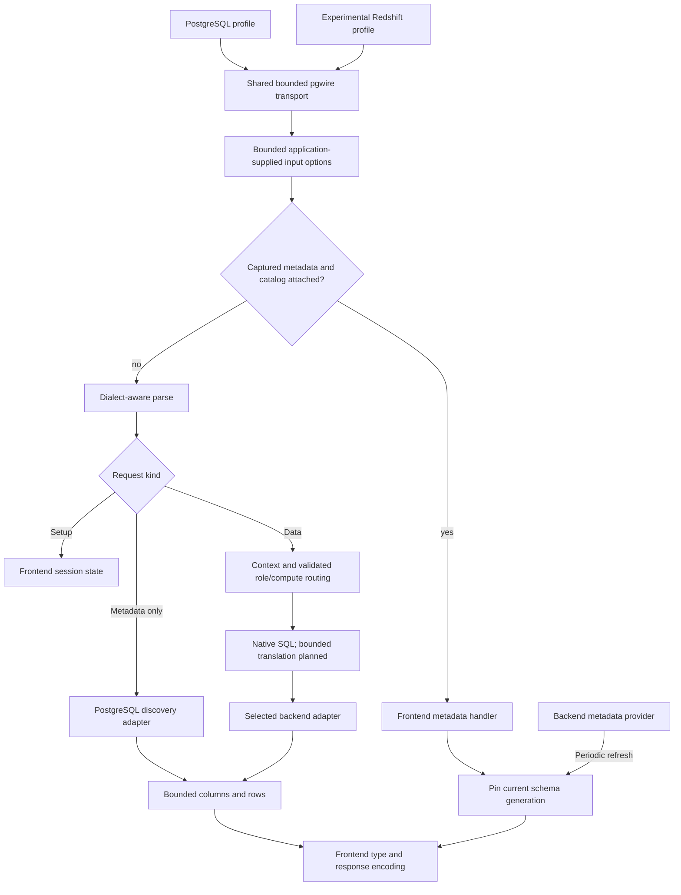

# Multi-engine compatibility

The runtime supports a PostgreSQL profile and an experimental Redshift profile
on shared pgwire transport. PostgreSQL backends and an optional experimental
Snowflake native-query adapter are integrated. Dialect-aware
input handling, shared query/transaction orchestration, typed execution boundaries,
and PostgreSQL execution/cache separation are implemented.
Shared, periodically refreshed schema snapshots and captured JDBC metadata handlers
are available through the library. Generated-SQL translation, remaining warehouse
metadata shapes and full Metabase acceptance remain pending. The YAML host can
attach a PostgreSQL catalog from its discovery binding, and the captured Metabase
Redshift table/field scans use it. See [JDBC setup](configuration.md#jdbc-clients).

## Intended contract

The initial target is Metabase's bundled PostgreSQL and Redshift JDBC drivers in
simple-query mode, with Redshift compression disabled. The
[client inventory](../scripts/compatibility/clients.json) records the observed
Metabase v0.64.2.8 image digest and bundled PostgreSQL 42.7.12 and Redshift 2.2.5
drivers. The bundled JDBC SQL corpus is captured in
[`jdbc_postgresql.json`](../tests/fixtures/jdbc_postgresql.json) and
[`jdbc_redshift.json`](../tests/fixtures/jdbc_redshift.json). Both drivers connect
over TLS in simple mode with an explicit application name. PostgreSQL passes
schemas/tables/columns/keys/indexes, previews, and read-only transaction checks.
Redshift passes the same captured operations. Schema, table and column responses
come from the shared snapshot; keys and indexes retain the PostgreSQL discovery path.
Actual Metabase query-builder workflows and protocol traffic capture remain required.

Each query executes on one selected backend. Eligible routes expose equivalent
logical tables and columns. Native Snowflake charts have Snowflake engine affinity;
cross-engine joins and arbitrary dialect translation are outside this milestone.

## Candidate Snowflake gate

The [network probe](../scripts/compatibility/README.md) isolates the Rust manager,
native driver, and emulator. The optional `snowflake` Cargo feature includes the
ADBC FFI/Arrow stack; default PostgreSQL builds do not. Python is test tooling,
not the production execution transport.

The Rust core/FFI and comparison manager are pinned to 0.24.0. The selected
native candidate is Apache Snowflake ADBC 1.11.0 with the checked-in stream-prefetch
patch, built with Go 1.26.1. The Python wheel remains an unmodified baseline.
Fakesnow 0.11.22, Connector 4.8.0, PyArrow 26.0.0, and DuckDB 1.5.6 pin the network
fixture. Separate locks pin Rust/Python dependencies; the native builder verifies
source/toolchain/patch digests and records the resulting library digest.

| Check | Observed result |
| --- | --- |
| Rust 1.89 build and native HTTP/Arrow reads | Pass. |
| `NUMBER(38,9)` and NULL through Rust C ABI | Exact Decimal128 value, precision, scale, and NULL. |
| Read-only transaction through native Rust C ABI | SELECT, rollback, and restored autocommit pass. |
| Rust manager connection cancel, against corrected emulator | Returns success; operation completes normally. |
| Rust manager statement cancel, against corrected emulator | Blocks until completion; operation completes normally. |
| Native C ABI cancellation, corrected emulator | Returns a context-cancellation error (native status 9); server confirms matching work stopped; connection can run another query. |
| Native C ABI cancellation, original no-op abort endpoint | Negative control: client cancellation does not stop server work. |
| Unmodified Apache 1.11.0 read-ahead | Downloads all sixteen later chunks before consumption, despite queue/prefetch limits of one. |
| Foundry 1.15.0 comparison | Bounds read-ahead; blocked-fetch cancellation returns success while downloads continue, so this artifact is not selected. |
| Patched Apache 1.11.0 read-ahead and fetch cancellation | No later chunks downloaded before consumption; all seventeen rows read correctly; cancelled download stops and connection recovers. |
| Synthetic transactional write/rollback | Fakesnow nested-transaction failure; diagnostic only, outside YASP's read-only acceptance surface. |

The Rust manager serializes statement execution and cancellation with one mutex.
The candidate replacement calls the existing native Snowflake ADBC C ABI directly
from Rust. ADBC 1.1 [requires StatementCancel to be thread-safe during execution](https://arrow.apache.org/adbc/current/cpp/api/group__adbc-statement.html).
The candidate connector's safe interface exclusively borrows connections and
statements for ordinary operations. Each single-use statement supplies a separate
cancellation handle; its lock covers cancellation/retirement, never blocking
execution or fetch. Arrow streams retain the statement; statements retain the
connection/database/driver. Stale cancellation handles cannot affect a subsequent
query. Probe checks cover execution errors, repeated statements, dropping the public
connection before a retained inactive handle, and balanced server session cleanup.
Source capacity stays owned until workers and cancellation handles release their
native parents. Rust manager dependency sources remain unchanged; Python stays
outside runtime execution.

Fakesnow's upstream abort endpoint acknowledges without interrupting work. The
pinned local fixture in `scripts/compatibility/fakesnow_cancel.py` matches the
session and request UUID, calls the emulator's DuckDB interrupt, and records when
the HTTP query handler stops. The query still uses Fakesnow's network interface and
normal execution path. Its private-API patch is test-only. The negative control
retains the original no-op abort behavior and verifies server work remains active
after the client returns. A local cancellation error alone is insufficient.

The native patch holds a semaphore slot for each stream until the consumer drains
it. The inline stream also occupies a slot. Cancelled scheduling closes channels
for streams that never started, allowing fetching and cleanup to finish. This
keeps the working cancellation path and the existing driver SQL/type behavior.
The corresponding upstream approach is documented in the
[Foundry 1.15.0 release](https://github.com/adbc-drivers/snowflake/releases/tag/go/v1.15.0).
The selected artifact backports the stream window onto the Apache version whose
execution and fetch cancellation pass the same fixture.

Run `build_native_driver.py`, then the probe with `--native-driver` as shown in
its README. The passing candidate report is
`target/compatibility/snowflake-patched-report.json`; the unmodified baseline report
remains `target/compatibility/snowflake-report.json` and fails read-ahead. Rust
manager and emulator negative controls remain part of the comparison.

Stream/queue limits bound concurrent buffered streams, not the largest Arrow
batch or total native RSS. The experimental runtime admits a bounded number of
blocking source workers, retains capacity through native cleanup, uses one queued
result event, and rejects oversized Arrow batches and frontend rows. The batch
check occurs after allocation; native RSS is not hard capped. Production readiness
still requires real Snowflake validation, full value coverage, source-role and
warehouse isolation, and deployment packaging.

Fakesnow imports converter APIs absent in Snowflake Connector 5.x. Its probe
environment pins Connector 4.8.0. The emulator does not establish source grants,
authentication security, or production semantic equivalence.

## Runtime foundations and planned engine boundaries

Metadata providers and snapshot responses are implemented. Generated-query
translation remains planned. Native Snowflake execution is implemented behind the
optional feature. Runtime flows are documented in [architecture](architecture.md).

Frontend profiles own authentication, startup parameters, advertised capabilities,
session commands, discovery-query recognition, and result encoding. PostgreSQL and
Redshift profiles share transport and connection lifecycle code. Each configured
listener selects one profile. PostgreSQL retains SCRAM;
the experimental Redshift profile uses password authentication over required TLS.
Its startup version is 8.0.2; exact version probes and the no-external-schema
existence probe are served locally.
PostgreSQL retains source-backed discovery/version behavior. Neither profile
advertises Redshift compression or extended metadata protocol capabilities.

The Redshift profile recognizes the driver's `SET readonly=0/1` as advisory
frontend commands; these never relax engine validation or source permissions.
Its exact `svv_external_schemas` existence probe returns an empty integer result
because this virtual frontend exports local namespaces. It does not claim Redshift
Spectrum/federated schema support. Redshift JDBC's legacy catalog-vector SQL uses
a PostgreSQL catalog grammar only after the normal Redshift grammar rejects it,
and only when the resulting AST passes the metadata-only classifier. Native SQL,
application data, and mixed catalog/application queries cannot take that path.

The optional `hooks.input_options` resolver interprets existing leading remarks.
`queryType: native` selects the configured native SQL dialect; MBQL, absent,
malformed, and unknown remarks select the frontend dialect. Both tokenization and
parsing use that dialect. Comments never authorize queries or grant discovery
access. Keep original SQL and its immutable AST; validate native engine affinity
after route selection. Mixed-dialect wrappers require explicit supported cases.

The [shared catalog](catalog.md) stores filtered source definitions in memory and
refreshes them periodically. PostgreSQL and Snowflake providers supply schema facts;
frontend handlers reproduce the captured JDBC schema/table/column result shapes
and Metabase's custom Redshift table/field scans.
Each response pins one generation, with source spelling, native type details and
qualified relation/column coordinates. Refresh failures retain the last valid
generation with visible status and a maximum age. The same handle is available to
future AST binders; alias/expression lineage and masking remain separate work.
Persistent storage, full constraints and additional driver shapes are not implemented.
Application row reads never use this catalog path.

Shared orchestration uses typed requests, results, errors, and pinned-session
dispatch. PostgreSQL messages and error fields stay opaque inside its native adapter
and pass through unchanged to frontend encoding. The core handles ordering and
policy; adapters handle source admission, session SQL, cancellation, cleanup, and
reuse. These private contracts do not expose native driver objects to hooks or
change existing public PostgreSQL entry points.
Snowflake configuration represents account/principal/role/database/schema/warehouse
directly rather than pretending to be a PostgreSQL host/port pool.

### Experimental native runtime

`backend::Backends` combines PostgreSQL pools with explicit Snowflake bindings;
`gateway::serve_backends` uses the existing selection hook and validates its
decision before acquisition. PostgreSQL remains the default metadata authority;
a host can attach a Snowflake catalog for the supported normalized responses.
Unknown Snowflake catalog requests fail explicitly. Native hints never use the
discovery connection. Default or generated SQL
selected for Snowflake fails explicitly until translation is supported.

Each Snowflake binding fixes account, principal, role, database, schema, warehouse,
driver path/digest, capacity, acquisition timeout, and batch bound. There is no
Snowflake connection reuse yet. A frontend transaction owns one source connection;
other queries open a fresh connection. Source grants must enforce read access.
The driver receives UTC session settings and rejects nanosecond timestamp overflow.
The library example and network test commands are described in
[configuration](configuration.md#experimental-snowflake-library-host).

Results preserve decimal values through precision 38, NULLs, booleans, signed
integers, floats, UTF-8 text, binary bytes, dates, times, and supported timestamps.
Nanosecond values with a nonzero sub-microsecond remainder fail instead of rounding.
Unrecognized Arrow types and non-UTC Arrow timezone representations fail explicitly.
The selected driver normalizes zoned timestamps to UTC; original timezone offsets
require an explicit text cast. Local timestamp coverage currently proves NTZ values;
real-source LTZ/TZ behavior remains an acceptance gate. Dates and timestamps outside
years 1–9999 fail explicitly. Text cannot
contain NUL. Common result columns advertise frontend type OIDs and decimal
precision/scale; PostgreSQL source results retain their original native encoding.

The runtime HTTP fixture verifies exact values and frontend column metadata, read-only transaction recovery,
native engine affinity, metadata-source isolation, SQL-error recovery, query
timeout, explicit CancelRequest, disconnect, and restored capacity. The three
interrupted source operations stop; all fixture sessions close. These
checks use pgwire clients, not the bundled Metabase/Redshift JDBC drivers.

Generated-query translation supports only captured and verified expression forms.
An AST's serialization does not establish equivalent semantics in another engine.
Test date boundaries, numeric coercion, NULL ordering, quoted names, and result
types. Unsupported operations fail explicitly. Native values beyond frontend
precision need an explicit cast or an error; never truncate them silently.

Preserve PostgreSQL result caching. New frontend/backend combinations initially
bypass it. Later cache support must include profile, effective SQL/dialect,
translation revision, role, warehouse, and serialization format in its scope.

## Remaining acceptance work

The [deliverables](deliverables.md) track runtime work separately from the candidate
probes. Required acceptance includes real Metabase connection/sync/exploration in
both modes; source-role and warehouse isolation; exact values and metadata;
transaction/cancellation/disconnect recovery; bounded workers and prefetch; and
explicit rejection of unsupported operations. Real Snowflake tests remain required
for authentication, grants, cancellation, and semantic equivalence.

Runtime validation uses the existing service-backed PostgreSQL matrix, including
Python and documentation variants.
Do not interpret a passing probe build or literal SELECT as completion of the
multi-engine adapter milestone.
