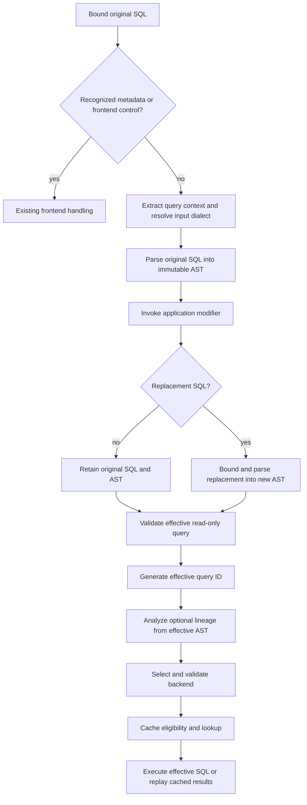

# Query modification

`hooks.modify_query` lets an application replace ordinary SQL after query context
extraction and parsing, before query IDs, lineage, backend selection, and caching.
The engine owns invocation, resource limits, SQL validation, and execution.
Applications own transformation rules and their semantic correctness.

## Stage order



The modifier runs once per ordinary query, including cache hits and source queries
inside explicit transactions. Metadata, frontend setup, empty queries, and
transaction controls retain their existing bypasses. Rewritten ordinary SQL never
re-enters frontend request recognition.

Context is extracted once from original SQL. Its values remain available downstream;
rewriting does not extract context again or change the resolved dialect.

## Rust contract

Public types are under `yasp::hooks`:

```rust
pub struct QueryModificationRequest<'a> {
    pub authenticated_user: &'a str,
    pub frontend_database: &'a str,
    pub client_id: u64,
    pub sql: &'a str,
    pub statement: &'a sqlparser::ast::Statement,
    pub dialect: SqlDialect,
    pub gateway_dialect: SqlDialect,
    pub default_target_dialect: Option<SqlDialect>,
    pub query_context: &'a serde_json::Map<String, serde_json::Value>,
    pub datasets: Option<&'a DatasetReader>,
}
```

The callback returns `Result<Option<String>, QueryModificationError>` in a borrowed
`BoxFuture`. Bind application state with `bind_modify_query(state, callback)` and
attach it with `GatewayConfig::with_query_modification_hook`:

```rust
use yasp::hooks::bind_modify_query;

let modifier = bind_modify_query((), |request, _state| {
    Box::pin(async move {
        if request.sql.trim() == "SELECT 7" {
            Ok(Some("SELECT 9".to_owned()))
        } else {
            Ok(None)
        }
    })
});
let gateway = gateway.with_query_modification_hook(modifier);
```

Application state is shared through an `Arc`. Callbacks can await dataset reads or
cooperative async I/O. Blocking Rust cannot be interrupted by the deadline.

For structural edits, clone `request.statement`, transform it in application code,
and return `Some(statement.to_string())`. The compiled
[table rename example](../hooks/examples/query_modifier.rs) handles qualified
base-table names with explicit aliases. Compile that module into the consuming
application and bind its `TableRename` state with `rename_table`.

There is no lineage, `data_contexts`, query ID, selected backend, credential, or
result classification in this request. Shared execution analyzes lineage afterward
from the effective query.

## Configuration and Python callbacks

```python
def modify_query(request, params) -> str | None:
    return params.get("sql_by_input", {}).get(request["sql"].strip())
```

```yaml
hooks:
  modify_query:
    type: rust
    callback: example.modify_query.rename_table
    params:
      from: public.orders
      to: reporting.orders_v2
```

The repository host compiles the [Rust table rename example](../hooks/examples/query_modifier.rs)
and registers `example.modify_query.rename_table`. Its required `from` and `to`
params are qualified SQL names, including quoted names when needed. Incoming
references to the renamed table must have explicit aliases. Unknown params or
invalid names fail startup. The example requires no Python feature.

Custom Python callbacks remain supported with `--features python` and a reference
containing `type: python`, an application-owned `path`, and `callback`. Paths resolve
relative to YAML. Python receives the Rust request's equivalent fields, using `query_ast` for the
parser's JSON AST and `datasets` for the existing scoped helper. It receives no
`query_id` or `data_contexts`. Each invocation gets fresh copied dictionaries;
editing them does not alter the execution query or later hook requests.

The Python function above illustrates exact application-controlled templates.
Comments, case, aliases, and semicolons affect its match. General transformations
require application AST handling or SQL tooling.

The repository host accepts its registered Rust example and Python references,
rejecting unknown compiled Rust names at startup. A consuming Rust host registers its own compiled callbacks using
the library API. There is no runtime Rust compilation or dynamic plugin registry.

## Output, validation, and failures

| Output | Behavior |
| --- | --- |
| Rust `Ok(None)` / Python `None` | Preserve original SQL byte for byte and reuse its AST. |
| Rust `Ok(Some(sql))` / Python string | Parse replacement SQL into a new immutable query and AST. |
| Rust error / Python exception | Reject the query without executing the original SQL. |

Every replacement, including an identical SQL string, is parsed in the resolved
incoming dialect. The old AST and serialized tree are never attached to replacement
SQL. Empty/comment-only output, multiple statements, syntax errors, unsupported
read-only operations, and SQL byte/token/recursion violations reject the query.
Backend-specific validation still runs after selection. NUL output is invalid.

`gateway.max_sql_bytes` bounds both incoming and replacement SQL. The existing
4,096 significant-token and parser-recursion limits apply. Python additionally
obeys its input/output payload, queue, and nesting bounds. The SQL byte bound does
not guarantee that its AST fits a configured Python payload bound.

`gateway.async_hook_timeout_ms` bounds modification. Python shares the existing
process runtime and its own execution deadline; executing timed-out Python retains
capacity until it finishes. Dataset access expires when its invocation ends or is
cancelled. Cancellation, disconnect, and shutdown stop waiting for the hook.

Explicit Rust denial returns `42501`; callback failure, timeout, invalid output
type, and Python exceptions return redacted `XX000`. Oversized SQL returns `54000`.
SQL validation preserves existing parser/resource error codes; cancellation returns
`57014`. No failure falls back to the unmodified query.

Query IDs are computed lazily from immutable SQL after modification and validation.
The normalization algorithm is unchanged. Selection, cache eligibility, result
processing, and execution receive the effective query and its ID. Lineage uses its
new AST and current catalog facts; missing facts remain explicit unknowns.

## Application use cases

### Rename a physical table

```sql
-- Incoming
SELECT o.id, o.total FROM analytics.orders AS o WHERE o.status = 'paid';
-- Effective
SELECT o.id, o.total FROM reporting.orders_v2 AS o WHERE o.status = 'paid';
```

Replace the base-table name in the AST and preserve alias `o`. Mappings can come
from application state or datasets. Without an alias, preserve the old exposed
relation name with an alias or update affected qualified references.

### Replace a table with a filtered subquery

```sql
-- Incoming
SELECT o.region, SUM(o.amount) FROM analytics.orders AS o GROUP BY o.region;
-- Effective for tenant 42
SELECT o.region, SUM(o.amount)
FROM (SELECT * FROM analytics.orders WHERE tenant_id = 42) AS o
GROUP BY o.region;
```

The application replaces the table factor with a derived relation, retaining its
alias. Filtering precedes aggregation. A controlled Python report can generate the
complete replacement without adding another parser:

```python
def modify_query(request, params):
    if request["sql"].strip() != params["input_sql"]:
        raise ValueError("unsupported report query")
    tenant_id = request["query_context"].get("tenant_id")
    if type(tenant_id) is not int or tenant_id <= 0:
        raise ValueError("missing valid tenant context")
    return f"""
        SELECT o.region, SUM(o.amount)
        FROM (SELECT * FROM analytics.orders WHERE tenant_id = {tenant_id}) AS o
        GROUP BY o.region
    """
```

Tenant restrictions require the application's verified identity contract. SQL
comments alone do not establish identity. Use typed AST literals or validated
values rather than inserting arbitrary SQL from context.

### Filter soft-deleted rows while preserving outer joins

```sql
-- Incoming
SELECT c.id, o.id FROM customers AS c
LEFT JOIN orders AS o ON o.customer_id = c.id;
-- Effective
SELECT c.id, o.id FROM customers AS c
LEFT JOIN (SELECT * FROM orders WHERE deleted_at IS NULL) AS o
  ON o.customer_id = c.id;
```

Filtering the joined relation retains customers without visible orders. An outer
WHERE condition can change which customer rows survive.

### Choose a tenant schema

```sql
-- Incoming
SELECT o.id, o.total FROM logical.orders AS o;
-- Effective for a verified tenant mapping
SELECT o.id, o.total FROM tenant_42.orders AS o;
```

Read the mapping through application datasets and construct identifier nodes.
Backend selection subsequently sees the effective relation and selects an
authorized configured route. The modifier itself selects no backend.

### Use a compatible summary table

```sql
-- Incoming
SELECT region, SUM(amount) AS revenue FROM analytics.orders GROUP BY region;
-- Effective
SELECT region, SUM(revenue) AS revenue FROM reporting.orders_daily GROUP BY region;
```

Applications check dimensions, filters, measure definitions, and freshness before
substitution. Optional optimizations can return no change for unsupported shapes.

### Apply a reporting period

```sql
-- Incoming
SELECT SUM(amount) FROM orders;
-- Effective
SELECT SUM(amount) FROM (
    SELECT * FROM orders
    WHERE created_at >= TIMESTAMP '2026-09-01 00:00:00'
      AND created_at < TIMESTAMP '2026-10-01 00:00:00'
) AS orders;
```

Validated context/datasets supply dates. Explicit dates distinguish reporting
periods in cache identity. A row cutoff is not a historical database snapshot.

### Cap interactive results

```sql
-- Incoming
SELECT id, total FROM orders ORDER BY id;
-- Effective
SELECT id, total FROM orders ORDER BY id LIMIT 1000;
```

Edit the query-level limit structurally, preserving smaller limits, ordering, and
offsets. This bounds returned rows rather than backend scan cost.

## Application correctness and cache isolation

General transformations account for CTE shadowing, quoted names, aliases,
self joins, nested queries, existing predicates, unions, limits, and offsets.
For example, a CTE named `orders` is not the physical table `public.orders`.
Applications reject unsupported shapes when a policy is mandatory. The engine
validates supported execution syntax, not transformation equivalence.

Modification runs before every cache lookup. Different effective tenant predicates
or tables produce different query IDs. Context is not automatically added to raw
cache identity: source filtering must appear in effective SQL or the existing
validated route/scope. Comments are excluded from fingerprints, so a tenant tag
only in a comment does not isolate cached results. Source grants/RLS on cached
data retain the existing expiry behavior. Explicit transactions bypass caching
and preserve existing route affinity and failed-transaction rules.
