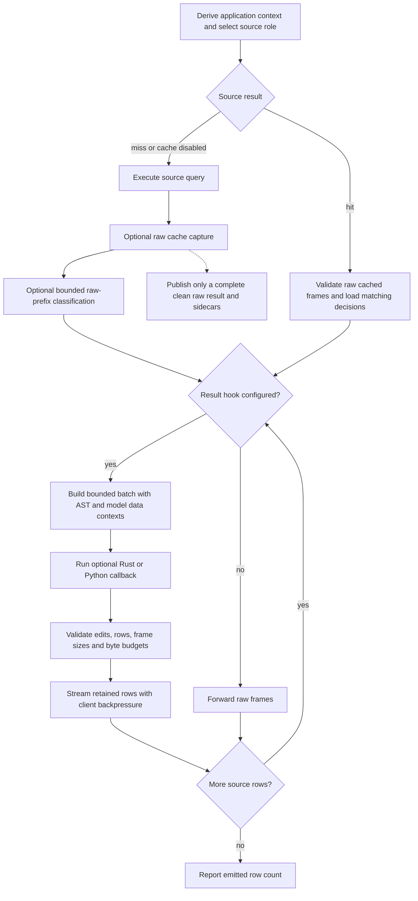

# Result processing

An optional `hooks.process_result` callback edits bounded chunks immediately before
client output. Rust and Python callbacks share the same contract. Each chunk has
complete rows across all output columns; callbacks can replace text, set any cell
to SQL NULL, or filter rows. Column metadata and retained-row order stay fixed.
Application hooks can apply presentation masks; see the [account policy example](../hooks/examples/rbac.py).
Engine-enforced masking and policy interpretation remain future capabilities.



Explicit transactions use the same processing stage without Redis. Catalog metadata,
frontend fingerprints, and session/control responses bypass application result hooks.
No hook is enabled by default; unconfigured queries retain direct row forwarding.

## Configuration and registration

```yaml
hooks:
  process_result:
    type: rust
    callback: builtin.process_result.uppercase
    params: { column: customer_name }

result_processing:
  max_rows_per_batch: 256
  target_batch_bytes: 262144
  max_buffered_bytes_total: 33554432
```

The supplied uppercase callback uses an exact, case-sensitive output name. Missing
or duplicate names and non-text columns fail the query. Unicode uppercase may
expand values; a replacement that exceeds an advertised VARCHAR/CHAR length fails
without truncation. NULLs stay NULL.

Compiled applications use `hooks::bind_process_result(state, callback)` and attach
the returned callback with `GatewayConfig::with_result_hook(hook, settings)?`.
The callback receives `ResultRequest<'_>`, `&mut ResultBatch`, and `Arc<State>` and
returns a boxed async future of `Result<(), ResultHookError>`. State is shared
across invocations; callbacks must use cooperative, nonblocking async code.
For the supplied Rust callback:

```rust
use yasp::{
    config::ResultProcessingSettings,
    hooks::{bind_process_result, builtin},
};

let gateway = gateway.with_result_hook(
    bind_process_result("customer_name".to_owned(), builtin::process_result::uppercase),
    ResultProcessingSettings::default(),
)?;
```

`ResultRequest` supplies authenticated frontend identity/database, client/query IDs,
original SQL and parsed query, validated target/login names, derived `context`,
invocation-scoped `datasets`, and raw output `data_contexts.ast` and
`data_contexts.decision_model`. Source credentials never reach callbacks. AST
entries are aligned with actual output ordinals. Disabled model classification is
absent; unavailable outcomes remain explicit uncertainty. Classification and lineage
describe the raw result, including rows later filtered out. Edits do not recompute them.

`ResultBatch` exposes `columns()`, `len()`, `column_index(name)`, `value(row, column)`,
and `text(row, column)`. NULL is distinct from empty text. Values remain native
UTF-8 protocol bytes; numeric, temporal, array, JSON, and binary encodings are not
parsed through JSON or floating point. `set_text` accepts only adapter-recognized
scalar text, `set_null` accepts any column, and `retain_rows(&[bool])` filters current
rows in order. Repeated filtering addresses the rows still present. Use ordinals
when output names are duplicated. Callbacks cannot change schema or insert rows.

## Python

Build with `--features python` and register `function(request, batch, params)` using
the existing process-wide `PythonRuntime`. Return `None`.

The native batch object provides `len(batch)`, `column_index(name)`,
`text_column(ordinal)`, `bytes_column(ordinal)`, `set_text(row, ordinal, value)`,
`set_null(row, ordinal)`, `replace_text_column(ordinal, values)`, and
`retain_rows(boolean_mask)`. Only requested columns are materialized as Python
lists. An untouched column is not converted to Python objects. SQL NULL is `None`;
Python lists never infer numeric or date types. Replacement columns and masks must
be Python lists; text replacements are `str` or None.
`hooks.python.max_payload_bytes` bounds admitted input and native output payloads.
A retained batch object expires when its invocation ends, including failed calls.

Query metadata and `request['columns']` are prepared once per result and expose
read-only mappings and tuples. `request['datasets']` is a fresh scoped helper for
each invocation. Python result jobs share existing queue count, byte admission,
GIL, import, shutdown, and execution-wait limits with other query hooks. No new
Python worker pool or dataframe dependency is required.

## Streaming, bounds, and failures

A batch flushes at its row/byte target, within 2 ms of its first row, or at completion.
Classification may first hold its existing bounded prefix until decisions are
available. One row larger than the byte target occupies a singleton batch within
existing frame and processing budgets; Python payload limits still apply.
One invocation per query is in flight, and the source channel permits only one
pending event. Client backpressure stops further reads rather than collecting
an entire result.

The aggregate budget covers engine-owned row buffers, field indexes, edits,
output copies, and Python metadata/column conversion allowances across sessions.
Adapter/socket buffers, raw cache capture, and model sampling have separate bounds.
Arbitrary Rust/Python callback heap allocation is outside these engine limits;
trusted embedded hooks are not a sandbox. Python jobs retain their buffers and
reservations until executing work finishes after a timeout or cancellation.
Rust deadlines require cooperative futures and cannot interrupt blocking code.

`gateway.async_hook_timeout_ms` bounds each hook wait, including Python queue time.
Frontend writes keep `gateway.write_timeout_ms`; a chunk has one write deadline.
Errors, invalid operations, unsupported replacement types, byte exhaustion, and
saturation fail the query. The affected batch is not sent as raw data. Previously
sent chunks cannot be retracted. Cancellation stops processing and awaits adapter
cleanup.

The cache stores every original source row and its original completion count.
Processing runs again for each caller on every hit. Application context and hook
versions do not change cache keys. Redis publication still requires a complete,
clean source result; processing never waits for a full-result cache fill before
streaming. The client completion count reports only emitted rows.

## Performance reference

Local release measurements (2026-10-21; 256 rows × 8 columns) uppercased one
column at 317–339k rows/s in Rust and 298–304k in Python, using PostgreSQL loopback
with TLS, cache, and inference disabled. Small batches favored native Rust and lazy
Python over dataframe conversion; Polars/pandas remain optional callback dependencies.

## Verification

Run functional coverage with the disposable service runner:

```sh
python3 scripts/test.py -- --test result_processing --features python
python3 scripts/test.py -- --test result_processing --features snowflake,python
```
