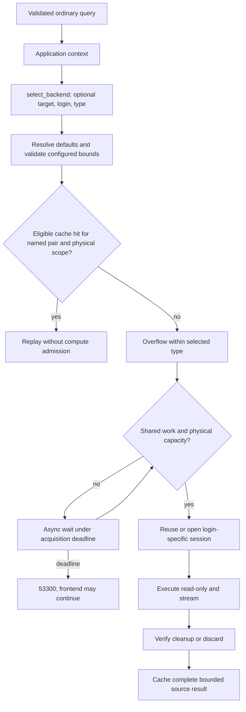

# Source access and compute routing

YASP has one application selector and an engine-owned overflow allocator. For the
full schema see [configuration](configuration.md#routing-and-pools) and
[config/example.yml](../config/example.yml). Native warehouse drivers, dynamic
masking, and compute lifecycle remain in the [product plan](PLAN.md).

## Decisions and responsibilities

```python
{"target": "olap", "backend_login": "restricted", "compute_type": "small"}
```

Every field is optional. The engine infers a sole target, then a sole login within
that target. For compute-enabled targets it uses the explicit default type or sole
type. Ambiguous omissions and invalid values deny the query. Python `None` is an
explicit denial; `{}` requests configured resolution. Ordinary targets require no
compute configuration and reject an explicit compute type.

| Decision | Owner |
| --- | --- |
| Source, access profile, workload class | Application `select_backend` callback |
| Omission resolution and configured eligibility | Engine |
| Available instance within the selected type | Engine overflow allocator |
| Credentials, native sessions, cleanup, cancellation | Backend adapter |
| User metadata meanings and source-role mappings | Consuming application |

Workload labels such as `small` and `large` do not imply machine sizes or automatic
SQL cost estimates. If OLTP and OLAP expose the same tables, the application supplies
its freshness rule or workload hint. SQL comments alone do not authenticate users.

## Optional compute configuration

Compute types belong to the target that needs them. Instances are an ordered list
within each type. Limits under a type apply independently to each instance and are
shared across all its logins. Other targets keep an ordinary endpoint.

```yaml
compute:
  default_type: small
  types:
    small:
      max_in_flight: 4
      max_connections: 8
      instances:
        - {id: small_a, host: "127.0.0.1", port: 5433}
        - {id: small_b, host: "127.0.0.1", port: 5434}
    large:
      max_in_flight: 8
      max_connections: 12
      instances:
        - {id: large_a, host: "127.0.0.1", port: 5435}
        - {id: large_b, host: "127.0.0.1", port: 5436}
```

Logins are defined once per target. Optional `allowed_computes` and complete
credential `overrides` describe exceptional bindings. The application verifies the
intended grants and RLS under every binding. Sharing a profile name does not prove
equivalent permissions.

## Query flow



A small query uses small_a while it can serve that login, then small_b. A large
query uses large_a, then large_b. Full small instances never cause automatic
escalation to large, another login, or another target. Pre-submission connection
failures can try another eligible instance; source permission failures and submitted
SQL are not replayed.

## Connections and burst load

Two logins and four instances describe eight possible pools. Connections open on
demand, with no per-pool prefill. Discovery may open its configured source at
startup. Global physical capacity need not cover the sum of all pool maxima.

- Per-pool limits cover one login/instance binding.
- Per-instance physical limits include all logins and idle sessions.
- The total physical budget covers all pooled source sessions, including creation
  and cleanup. It is released only when a physical connection closes.
- Idle pressure reclamation makes capacity available to another binding without
  interrupting active queries.
- Per-instance work limits cover acquisition, execution, and cleanup across logins.

When capacity is full, the existing async runtime waits for a reservation up to
`backend.acquire_timeout_ms` (60 seconds by default), then returns `53300`.
Waiting occupies a bounded frontend session,
not a dedicated thread. Cancellation can stop the wait. This is local bounded
admission, not a durable Redis queue or provider-wide utilization measurement.

## Cache, discovery, and future work

Redis keys combine a version marker, configured target/login names, and normalized
SQL query ID. Entry scope also checks physical source/instance, frontend identity,
and fixed session/execution settings. Overflow adjusts capture scope to the actual
binding. Source grants are checked on execution, not on cache hits, until TTL expiry.

Discovery bypasses policy callbacks and cache. Its explicit instance uses the same
physical and work limits. Session reset and setup remain adapter-owned; returning
one login's connection cannot suspend compute shared by other logins.

A masking deployment may use fewer source logins, but still selects a source pair
for execution and caching. Current masks must eventually run after both hits and
misses before output; masking is not implemented yet.

Phase 2 includes a Redis query queue with ownership, deadlines, cancellation, and
recovery semantics. Phase 3 adds round-robin and least-busy distribution, plus
provider-specific compute lifecycle. See [deliverables](deliverables.md). Application
RBAC and real BI metadata validation remain deployment-specific work.
